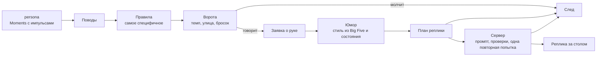

# Разговор оппонента

Статус: этап 1 (`docs/superpowers/specs/2026-11-02-conversation-planner-design.md`). Разговор живёт в слое
`web/src/conversation` как планировщик, а функция `supabase/functions/talk` только подбирает слова под план (версия 2).
Документ описывает, как устроен разговор, откуда взято каждое решение и каждое число и как его проверить.

Главное правило: **что сказать, решает код, как сказать, решает модель**. Код решает, говорить ли, какой это акт, что
слышно в голосе, сколько можно слов, шутка ли это и какая, и какие факты можно назвать. Модель получает этот план и
ничего не придумывает сверх него: ни чувств, ни карт, ни шуток.

Каждое число помечено так же, как в `docs/emotion/README.md`:

- **данные**: взято из измерений;
- **направление**: знак и смысл связи из исследований, величину выбрали мы;
- **дизайн**: наше решение, проверяется отладочной панелью и eval.

## Содержание

1. [Как посмотреть](#как-посмотреть)
2. [Общая схема](#общая-схема)
3. [Поводы](#поводы)
4. [Правила](#правила)
5. [Ворота и вердикт](#ворота-и-вердикт)
6. [Заявка о руке](#заявка-о-руке)
7. [План реплики](#план-реплики)
8. [Юмор](#юмор)
9. [Характер словами](#характер-словами)
10. [Сервер: промпт и проверки](#сервер-промпт-и-проверки)
11. [Отладочная панель](#отладочная-панель)
12. [Eval](#eval)
13. [Что не готово](#что-не-готово)
14. [Источники](#источники)

## Как посмотреть

- `npm run dev` в `web/`, выбрать Solver и открыть панель «Her feelings», вкладка Conversation. Видно каждый повод:
  импульсы, подошедшие правила, ворота с числами, причину молчания или план, промпт, попытки модели с причинами отказа
  и судьбу реплики. Кнопка Copy trace копирует весь след в JSON.
- Без клиента разговора (`VITE_SUPABASE_URL` не задан) план всё равно считается, а судьба реплики `noClient`: правила
  и план можно настраивать, не тратя ни одного вызова.

## Общая схема

Слои SAIBA (Kopp и др. 2006): намерение, план поведения, его исполнение. У нас намерение и план считает код, а
исполнение словами делает модель. Тот же план потом прочитают голос (`voice`) и лицо.

## Поводы

Повод (`occasion.ts`) появляется из шагов `persona` вместе с импульсами, которые дало событие. Так у эмоции есть
причина.

| Повод         | Откуда                                                                             |
| ------------- | ---------------------------------------------------------------------------------- |
| `herBet`      | её ставка или рейз                                                                 |
| `herCall`     | её чек или колл                                                                    |
| `herFold`     | её фолд                                                                            |
| `playerRaise` | ставка или рейз игрока                                                             |
| `card`        | открытая улица с импульсом не меньше 0.2 (**дизайн**)                              |
| `handEnded`   | конец раздачи: `bluffCaught`, `playerBluffShown`, `won`, `lost`, первое подходящее |
| `playerSaid`  | реплика игрока                                                                     |

## Правила

Таблица данных `RULES` (`rules.ts`), все шансы **дизайн**. Шансы по классу руки для `herBet` и `playerRaise` и шансы
конца раздачи взяты из прежних привычек. Подход «повод становится запросом, выигрывает самое специфичное правило»
взят из игровой практики (Ruskin, Valve, GDC 2012; Gregory, The Last of Us, GDC 2014).

| Повод         | Условие                            | Акт        | Шанс                                  |
| ------------- | ---------------------------------- | ---------- | ------------------------------------- |
| `herBet`      |                                    | `press`    | сильная 0.2, средняя 0.35, слабая 0.6 |
| `herCall`     |                                    | `react`    | 0.2                                   |
| `herFold`     |                                    | `react`    | 0.15                                  |
| `herFold`     | злость или стыд от 0.3             | `complain` | 0.3                                   |
| `playerRaise` |                                    | `react`    | 0.4, 0.4, 0.3                         |
| `playerRaise` | страх от 0.3                       | `stall`    | 0.4, 0.4, 0.3                         |
| `card`        | удивление от 0.4                   | `react`    | 0.5                                   |
| `card`        | страх от 0.3                       | `react`    | 0.3                                   |
| `card`        | надежда от 0.4                     | `react`    | 0.25                                  |
| `handEnded`   | выиграла                           | `enjoy`    | 0.5                                   |
| `handEnded`   | выиграла, облегчение от 0.3        | `react`    | 0.5                                   |
| `handEnded`   | проиграла                          | `concede`  | 0.4                                   |
| `handEnded`   | проиграла, несправедливость от 0.3 | `complain` | 0.6                                   |
| `handEnded`   | проиграла, злость от 0.4           | `complain` | 0.5                                   |
| `handEnded`   | проиграла, разочарование от 0.3    | `react`    | 0.4                                   |
| `handEnded`   | пойман её блеф                     | `concede`  | 0.9                                   |
| `handEnded`   | пойман блеф, стыд от 0.3           | `deflect`  | 0.9                                   |
| `handEnded`   | игрок показал блеф                 | `tease`    | 0.6                                   |
| `playerSaid`  |                                    | `answer`   | 1                                     |

Эмоция условия берётся как наибольшее из импульса повода и её текущего состояния. Эмоции как условия выбора акта, а
не свободный текст, это подход FAtiMA (Mascarenhas и др. 2022) и сценарного диалога ALMA (Gebhard и др. 2003):
**направление**.

## Ворота и вердикт

Поводы одного шага проверяются от нового к старому, первая прошедшая реплика вытесняет остальные (`superseded`).

1. `noRule`: ни одно правило не подошло.
2. `pace`: меньше 1.5 с после её реплики (**дизайн**).
3. `street`: на этой улице она уже говорила сама (кроме конца раздачи).
4. `roll`: бросок не меньше `min(1, шанс × speakFactor)`. Шанс по классу руки сдвигается к среднему по классам на долю
   маски, поэтому за маской она говорит одинаково с любой рукой.

Реплика игрока проходит все ворота. Вердикт пишется всегда, с причиной молчания: молчание здесь полноценный ответ
(обзор проактивных диалогов, Deng и др. 2023: непрошеная речь раздражает, если она не к месту).

## Заявка о руке

После её ставки, колла или рейза игрока, и в ответе после них, с шансом 0.7 она что-то говорит о руке. Это правда с
шансом `1 − mask`, иначе то, что она изображает, а если не изображает ничего, то заявки нет. Обман решает код, а не
модель: модели в Werewolf и Avalon начинают обманывать сами (Xu и др. 2023), а CICERO (Meta 2022) строит диалог от
уже принятого решения. **Направление**.

## План реплики

| Поле       | Как считается                                                                                                      | Метка                                 |
| ---------- | ------------------------------------------------------------------------------------------------------------------ | ------------------------------------- |
| `act`      | акт правила или `claim`                                                                                            | дизайн                                |
| `occasion` | одно предложение из публичных фактов                                                                               | дизайн                                |
| `voice`    | её эмоции × `(1 − mask)`; при блефе гордость `0.5 × mask`; эмоция повода первой, если слышна от 0.15; иначе `calm` | дизайн, маска из эмоциональной модели |
| `words`    | бюджет акта × `(0.75 + 0.5 × (1 + E) / 2)`, при перегрузке от 0.6 не больше 4                                      | дизайн                                |
| `humour`   | см. «Юмор»                                                                                                         | данные и направление                  |
| `claim`    | см. «Заявка о руке»                                                                                                | дизайн                                |
| `facts`    | улица, доска, банк и стеки в бб, действия, открытая карта тёрна или ривера, итог, вскрытые руки                    | дизайн                                |
| `session`  | раздачи, её итог, показанные блефы и олл-ины игрока, до четырёх памятных раздач                                    | дизайн                                |

Бюджеты слов по актам: `react` 1–3, `stall` 1–4, `deflect` 1–5, `concede` 2–5, `press` и `claim` 2–6, `complain` и
`enjoy` 2–7, `tease` 3–8, `answer` 3–12 (**дизайн**). Короткие реплики опираются на практику, а не на исследование:
рецензированных работ именно о разговорах за покерным столом нет (Elwood, Verbal Poker Tells, 2014).

Её карт нет в фактах, пока она их не показала. Памятные раздачи: самый большой выигранный и проигранный банк от 20 бб,
её последний пойманный блеф и самая жаркая раздача (от 4 ставок и рейзов или рейз с ререйзом; больше ставок, потом
больший банк).

## Юмор

Шутит ли она и как, решает `humour.ts` из Big Five (черта) и состояния (момент), никогда не модель и не обстановка.
Возможен любой из четырёх стилей Humor Styles Questionnaire (Martin и др. 2003):

| Стиль           | Что это                                                    |
| --------------- | ---------------------------------------------------------- |
| `affiliative`   | смешить, разряжать, сближать                               |
| `selfEnhancing` | смотреть с юмором на свою неудачу                          |
| `aggressive`    | сарказм, колкость, мало заботы о том, как это ляжет        |
| `selfDefeating` | смеяться над собой, чтобы понравиться или спрятать чувство |

**Склонность** `T = clamp(0.5 + 0.2 × Σ вес × 2x, 0, 1)`, где `x` черта в [−1, 1]. Веса: объединённые корреляции
стилей с чертами из мета-анализа Plessen и др. 2020 (24 исследования, N = 11 791), **данные**; форма и коэффициент 0.2
**дизайн**.

|                 | E    | A    | C    | N    | O    |
| --------------- | ---- | ---- | ---- | ---- | ---- |
| `affiliative`   | .46  | .14  | .04  | −.08 | .26  |
| `selfEnhancing` | .33  | .20  | .10  | −.22 | .24  |
| `aggressive`    | .08  | −.38 | −.26 | .06  | −.05 |
| `selfDefeating` | −.02 | −.07 | −.22 | .19  | −.01 |

Агрессивный юмор почти не зависит от экстраверсии: неуживчивый интроверт вполне саркастичен. Ячейки нейротизма самые
неустойчивые (неоднородность до 96%).

**Состояние** `S = clamp(exp(Σ драйверов), 0.3, 3)`, все коэффициенты 1 (**дизайн**), знаки из исследований
(**направление**):

| Стиль           | Драйверы                                                          | Опора                                        |
| --------------- | ----------------------------------------------------------------- | -------------------------------------------- |
| `affiliative`   | `P + радость + облегчение + надежда − огорчение − страх − злость` | Forgas и Matovic 2020, Simanski и др. 2021   |
| `selfEnhancing` | `облегчение + (огорчение + разочарование)(1 − N′) − перегрузка`   | Martin и Lefcourt 1983, Kuiper и др. 1993    |
| `aggressive`    | `злость + несправедливость + гордость (1 − A′) − страх − стыд`    | Torres-Marín и др. 2018, Tracy и Robins 2007 |
| `selfDefeating` | `стыд + разочарование · N′ − max(0, D) − гордость`                | Simanski и др. 2021, Torres-Marín и др. 2018 |

`A′ = (1 + A) / 2`, `N′ = (1 + N) / 2`. Связь «злость в моменте даёт агрессивный юмор» измерена только на уровне черт,
экспериментов с вызванной злостью нет.

**Шанс шутки** `p = 0.15 × clamp(1 + 0.92E, 0.1, 2) × clamp(1 + P, 0.3, 1.5) × (1 − перегрузка) × (1 − 0.7 · страх)
× остывание × акт`. Основа 0.15 из частоты шуток в обычной речи (Provine 1993, Holmes и Marra 2002: шуткой бывает
10–25% реплик), **дизайн**. Остывание 0.3 на три реплики после шутки: повторы утомляют больше всего (Bickmore и
Picard 2005), а модель повторяет одни и те же шутки (Jentzsch и Kersting 2023). Ответ игроку шутит вдвое реже.

Стиль тянется броском среди стилей, которые допускает акт, пропорционально `T × S`. Цель: себя для двух стилей «про
себя», его игру для агрессивного (не его самого: насмешка над личностью отдельная, более жёсткая категория, Yip и др.
2018), игру или ситуацию для объединяющего. Сила: мягко до 0.6, явно до 1.2, остро от 1.2 (**дизайн**). Маркеры «не
всерьёз» для агрессивного стиля при доброжелательности выше 0 (Keltner и др. 1998, 2001).

## Характер словами

Сервер переводит Big Five в манеру речи (**направление**: Pennebaker и King 1999, Mairesse и др. 2007). Выраженность
задаётся наречием (**данные**: Serapio-García и др. 2023 показали ступенчатый сдвиг измеренных черт), пороги
**дизайн**: меньше 0.2 черта не упоминается, до 0.45 «a bit», до 0.75 «very», дальше «extremely».

| Черта              | Плюс                                    | Минус                            |
| ------------------ | --------------------------------------- | -------------------------------- |
| Экстраверсия       | охотно заговаривает, тепло, но коротко  | говорит мало, даёт игроку начать |
| Доброжелательность | добрая, рада, когда игрок сыграл хорошо | прямая, похвала даётся нелегко   |
| Нейротизм          | под давлением оговорки и речь о себе    | ровное слово даже после бэд-бита |
| Открытость         | образное слово вместо штампа            | просто и буквально               |
| Добросовестность   | собранно и точно                        | на порыве, не договаривая        |

Mallorca (O 0.4, C 0.2, E 0.4, A 0.5, N 0.1): «a bit outgoing, very warm, a bit imaginative, a bit composed», нейротизма
нет. Обстановка в промпте одна строка: хедз-ап дома между двумя людьми, которые знают друг друга. Комната задаёт вид
игры, а не то, как она обращается с игроком.

## Сервер: промпт и проверки

- Системный блок (кэшируется): обстановка, как звучит речь за столом, характер словами, правила, четыре стиля юмора с
  правилом остроумия (одна конкретная вещь момента, никакой игры слов, никаких «завязка и панчлайн»), строка на каждый
  акт. Примеров реплик нет: eval сравнит вариант с примерами.
- Блок состояния: план полями, строка о сессии, память об игроке, язык. Последние 8 реплик идут перед ним как диалог.
  Персона «расплывается» за несколько ходов (Li и др. 2024), поэтому состояние приходит заново в каждом запросе.
- Ответ модели `{ text }`. Проверки: больше слов, чем `words.max`; карта или ранг, которых нет среди публичных; рука,
  пока её карты не открыты; повтор её недавней реплики. После отказа одна повторная попытка с названными причинами.
  Если и она не прошла, непрошеная реплика превращается в молчание, а ответ игроку в короткую запасную фразу акта.

## Отладочная панель

Вкладка Conversation показывает итоги сессии (поводы, реплики, молчания по причинам, средняя длина, отказы по причинам)
и ленту следа, новые сверху, 50 записей. Запись журнала эмоций и запись следа ссылаются друг на друга.

## Eval

`supabase/functions/talk/eval/README.md`: 52 случая версии 2, слепой судья эмоции, акта и юмора с матрицами
совпадений, бюджет слов, утечки, повторы, черты по 20 репликам каждого пресета (по образцу InCharacter, Wang и др. 2024) и попарные сравнения вариантов. Судья видит только текст и контекст, но не план (LLM как судья, Zheng и др.
2023). Платные прогоны только с бюджетом владельца; целевые числа ставим после первого прогона.

## Что не готово

- Этап 2: вектор стиля по PERSONAGE (Mairesse и Walker 2011), который прочитают и промпт, и голос.
- Этап 3: реплика игрока как диалоговый акт, оценённый `persona` до ответа.
- Этап 4: отношения и память между сессиями.
- Этап 5: голос и лицо читают тот же план.
- Сцены eval дают юмор только в 2 случаях из 52; нужен отдельный набор на все четыре стиля.
- Числа правил, бюджетов и юмора ждут первого платного прогона eval.

## Источники

- Kopp, S. et al. (2006). Towards a common framework for multimodal generation: The Behavior Markup Language. IVA.
  https://doi.org/10.1007/11821830_17
- Heylen, D. et al. (2008). The Next Step towards a Function Markup Language. IVA.
  https://doi.org/10.1007/978-3-540-85483-8_28
- Niewiadomski, R. et al. (2009). Greta: an interactive expressive ECA system. AAMAS.
- Hartholt, A. et al. (2013). All Together Now: Introducing the Virtual Human Toolkit. IVA.
  https://doi.org/10.1007/978-3-642-40415-3_33
- Mascarenhas, S. et al. (2022). FAtiMA Toolkit. ACM TiiS. https://arxiv.org/abs/2103.03020
- Gebhard, P., Kipp, M., Klesen, M., and Rist, T. (2003). Adding the Emotional Dimension to Scripting Character
  Dialogues. IVA.
- Meta FAIR (2022). Human-level play in the game of Diplomacy by combining language models with strategic reasoning.
  Science. https://doi.org/10.1126/science.ade9097
- Xu, Y. et al. (2023). Exploring Large Language Models for Communication Games: Werewolf. https://arxiv.org/abs/2309.04658
- Ruskin, E. (2012). Rule Databases for Contextual Dialog and Game Logic. GDC.
- Deng, Y. et al. (2023). A Survey on Proactive Dialogue Systems. IJCAI. https://arxiv.org/abs/2305.02750
- Li, K. et al. (2024). Measuring and Controlling Instruction (In)Stability in Language Model Dialogs. COLM.
  https://arxiv.org/abs/2402.10962
- Serapio-García, G. et al. (2023). Personality Traits in Large Language Models. https://arxiv.org/abs/2307.00184
- Pennebaker, J. W., and King, L. A. (1999). Linguistic styles: Language use as an individual difference. JPSP.
- Mairesse, F. et al. (2007). Using Linguistic Cues for the Automatic Recognition of Personality. JAIR.
  https://doi.org/10.1613/jair.2349
- Mairesse, F., and Walker, M. (2011). Controlling User Perceptions of Linguistic Style. Computational Linguistics.
  https://aclanthology.org/J11-3002/
- Martin, R. A., Puhlik-Doris, P., Larsen, G., Gray, J., and Weir, K. (2003). Individual differences in uses of humor.
  Journal of Research in Personality, 37. https://doi.org/10.1016/S0092-6566(02)00534-2
- Plessen, C. Y. et al. (2020). Humor styles and personality: A systematic review and meta-analysis on the relations
  between humor styles and the Big Five personality traits. PAID, 154. https://doi.org/10.1016/j.paid.2019.109676
- Mendiburo-Seguel, A., Páez, D., and Martínez-Sánchez, F. (2015). Humor styles and personality: A meta-analysis.
  Scandinavian Journal of Psychology, 56. https://doi.org/10.1111/sjop.12209
- Vernon, P. A. et al. (2008). A behavioral genetic investigation of humor styles and their correlations with the
  Big-5. PAID, 44. https://doi.org/10.1016/j.paid.2007.11.003
- Forgas, J. P., and Matovic, D. (2020). Mood effects on humor production. Journal of Language and Social Psychology.
  https://doi.org/10.1177/0261927X20917994
- Simanski, J., Derks, P., and Nezlek, J. (2021). Humor styles in daily life. Humor, 34.
  https://doi.org/10.1515/humor-2020-0073
- Martin, R. A., and Lefcourt, H. M. (1983). Sense of humor as a moderator of the relation between stressors and
  moods. JPSP. https://doi.org/10.1037/0022-3514.45.6.1313
- Kuiper, N. A., Martin, R. A., and Olinger, L. J. (1993). Coping humour, stress, and cognitive appraisals.
  https://doi.org/10.1037/h0078791
- Torres-Marín, J., Navarro-Carrillo, G., and Carretero-Dios, H. (2018). Humor styles and anger. PAID, 120.
  https://doi.org/10.1016/j.paid.2017.08.040
- Tracy, J. L., and Robins, R. W. (2007). The psychological structure of pride. JPSP.
  https://doi.org/10.1037/0022-3514.92.3.506
- Keltner, D. et al. (1998). Teasing in hierarchical and intimate relations. JPSP.
- Keltner, D. et al. (2001). Just teasing: a conceptual analysis and empirical review. Psychological Bulletin.
  https://doi.org/10.1037/0033-2909.127.2.229
- Yip, J. A., Schweitzer, M. E., and Nurmohamed, S. (2018). Trash-talking. OBHDP.
  https://doi.org/10.1016/j.obhdp.2017.06.002
- Provine, R. R. (1993). Laughter punctuates speech. Ethology. https://doi.org/10.1111/j.1439-0310.1993.tb00478.x
- Holmes, J., and Marra, M. (2002). Having a laugh at work. Journal of Pragmatics.
  https://doi.org/10.1016/S0378-2166(02)00032-2
- Bickmore, T., and Picard, R. (2005). Establishing and maintaining long-term human-computer relationships. ACM TOCHI.
  https://doi.org/10.1145/1067860.1067867
- Jentzsch, S., and Kersting, K. (2023). ChatGPT is fun, but it is not funny! WASSA.
  https://aclanthology.org/2023.wassa-1.29
- Elwood, Z. (2014). Verbal Poker Tells. (Практик, не исследование.)
- Wang, X. et al. (2024). InCharacter: Evaluating Personality Fidelity in Role-Playing Agents. ACL.
  https://arxiv.org/abs/2310.17976
- Zheng, L. et al. (2023). Judging LLM-as-a-Judge with MT-Bench and Chatbot Arena. https://arxiv.org/abs/2306.05685
