# Эмоциональная модель оппонента

Статус: модель живёт в игре как слой `web/src/emotion`; персонаж за столом (`web/src/persona`) кормит её событиями
настоящих раздач, и от неё идут перекос игры бота, лицо, голос и состояние для промпта. Песочница
`web/prototypes/emotion-lab` показывает ту же модель с лицом и голосом. Лицо и голос живут и в игре: чистый
слой `web/src/face` считает выражение, покерфейс, реакции, тики, виземы и интонацию, а `web/src/ui/avatar` рисует
её за столом (issue #64). Документ описывает, как устроена модель,
откуда взята каждая формула и каждое число, и как это проверить руками.

Единственный источник правды: **эмоциональное состояние персонажа**. Перекос игры, лицо, голос и реплики
выводятся из него и обратно на него не влияют. Исключение одно: реплики игрока в чате оцениваются как события.

## Содержание

1. [Как запустить](#как-запустить)
2. [Общая схема](#общая-схема)
3. [Слой 1. Личность](#слой-1-личность)
4. [Слой 2. Эмоции](#слой-2-эмоции)
5. [Оценка событий за столом](#оценка-событий-за-столом)
6. [Слой 3. Настроение](#слой-3-настроение)
7. [Перегрузка и доступ к игре](#перегрузка-и-доступ-к-игре)
8. [Перекос игры](#перекос-игры)
9. [Лицо](#лицо)
10. [Голос](#голос)
11. [Сцены](#сцены)
12. [Связь с разговорным агентом](#связь-с-разговорным-агентом)
13. [Что не готово](#что-не-готово)
14. [Источники](#источники)

## Как запустить

Из `web/`, после `source ~/.nvm/nvm.sh && nvm use`:

| Команда                                                                                      | Что делает                                                                           |
| -------------------------------------------------------------------------------------------- | ------------------------------------------------------------------------------------ |
| `npm run lab`                                                                                | Поднимает Vite и открывает песочницу `http://localhost:5173/prototypes/emotion-lab/` |
| `npx vitest run --project node src/emotion src/persona src/face src/conversation prototypes` | Тесты модели, персонажа, лица, разговора и сцен                                      |
| `npm run lab:shots`                                                                          | Перерисовывает все картинки этого документа в `docs/emotion/img/`                    |
| `npm run lab:report`                                                                         | Перегенерирует `docs/emotion/generated.md`: таблицу профилей и журналы всех сцен     |

Песочница принимает параметры адреса для воспроизводимых кадров: `?scene=badbeat&profile=lola&at=9&seed=1`
прокручивает сцену до 9 секунды с фиксированным зерном и замирает. Так сделаны все скриншоты ниже.

Модель лица `web/public/avatar/mallorca.glb`: `Female_Adult_07` из библиотеки Microsoft Rocketbox (лицензия MIT), с 52
блендшейпами ARKit и 15 виземами Oculus, переведённая скриптом `web/tools/avatar/convert.py`. Та же модель стоит за
столом в игре.

## Общая схема

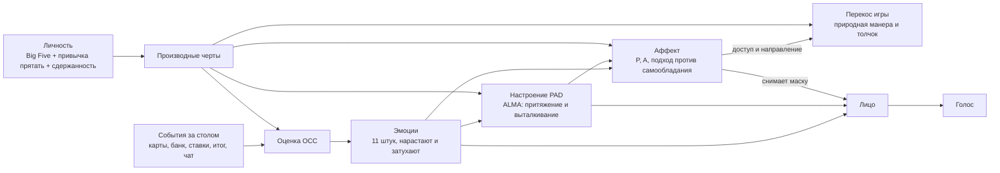

Слои живут в разных масштабах времени, как в модели ALMA (Gebhard, 2005):

| Слой            | Время жизни                                             | Код                                                                                                                                     |
| --------------- | ------------------------------------------------------- | --------------------------------------------------------------------------------------------------------------------------------------- |
| Личность        | не меняется                                             | `src/emotion/personality.ts`, `src/emotion/profiles.ts` (Mallorca), `prototypes/emotion-lab/profiles.ts` (внешность профилей песочницы) |
| Эмоции          | секунды и раздачи, у каждой есть повод                  | `src/emotion/emotions.ts`, `src/emotion/appraisal.ts`                                                                                   |
| Настроение      | десятки раздач и часы, повода нет                       | `src/emotion/mood.ts`                                                                                                                   |
| Аффект и манера | считается заново в каждый момент из эмоций и настроения | `src/emotion/play.ts`                                                                                                                   |

Каждое число в модели помечено одной из трёх меток:

- **данные**: взято из измерений (статья с цифрами);
- **направление**: из исследований взят знак и смысл связи, величину выбрали мы;
- **дизайн**: наше решение без опоры на исследование, проверяется глазами и ареной.

## Слой 1. Личность

### Входные параметры

Пять факторов (Big Five), каждый в диапазоне [-1, 1], плюс привычка прятать эмоции. Отдельной сдержанности нет: черта самоконтроля идёт с высокой добросовестностью и низким нейротизмом, и второй рычаг в основном повторял бы Big Five.

| Параметр                      | Смысл                                                 | Метка             |
| ----------------------------- | ----------------------------------------------------- | ----------------- |
| Открытость O                  | любопытство, восприимчивость к новому                 | данные (Big Five) |
| Добросовестность C            | собранность, самоконтроль                             | данные (Big Five) |
| Экстраверсия E                | общительность, положительные эмоции, выразительность  | данные (Big Five) |
| Доброжелательность A          | мягкость, склонность не злиться на людей              | данные (Big Five) |
| Нейротизм N                   | эмоциональная неустойчивость, сила негативных эмоций  | данные (Big Five) |
| Привычка прятать эмоции, 0..1 | подавление выражения по Гроссу (Gross and John, 2003) | направление       |

### Настроение по умолчанию

Формула Мехрабиана (Mehrabian, 1996) в том виде, как её использует ALMA. В статье ALMA третий член назван
нейротизмом, но в оригинале Мехрабиана это эмоциональная устойчивость (stability). Пример из статьи ALMA (O 0.4,
C 0.8, E 0.6, A 0.3, третий член 0.4 даёт «slightly relaxed») совпадает только с устойчивостью, поэтому берём
`stability = -N`:

```
P = 0.21·E + 0.59·A + 0.19·stability
A = 0.15·O + 0.30·A − 0.57·stability
D = 0.25·O + 0.17·C + 0.60·E − 0.32·A
```

Это точка, к которой настроение возвращается, когда эмоций нет. От неё же зависит выражение лица в покое.

### Производные черты

Все формулы в `src/emotion/personality.ts`, функция `traitsOf`.

| Черта                                           | Формула                                                              | Смысл                                                                 | Метка и источник                                                                        |
| ----------------------------------------------- | -------------------------------------------------------------------- | --------------------------------------------------------------------- | --------------------------------------------------------------------------------------- |
| Усиление радости, надежды, облегчения, гордости | `1 + 0.25·E`                                                         | экстраверты сильнее переживают хорошее                                | направление: экстраверсия связана с положительным аффектом                              |
| Усиление страха                                 | `1 + 0.4·N`                                                          |                                                                       | направление: нейротизм усиливает негативные реакции (Suls and Martin, 2005)             |
| Усиление огорчения и разочарования              | `1 + 0.35·N`                                                         |                                                                       | направление, там же                                                                     |
| Усиление стыда                                  | `1 + 0.25·N + 0.2·C`                                                 | добросовестные сильнее переживают свои ошибки                         | направление                                                                             |
| Усиление злости                                 | `1 + 0.2·N − 0.35·A`                                                 | доброжелательные меньше злятся на людей                               | направление                                                                             |
| Усиление несправедливости                       | `1 + 0.35·N − 0.15·A`                                                |                                                                       | направление                                                                             |
| Усиление удивления                              | `1 + 0.2·O`                                                          |                                                                       | дизайн                                                                                  |
| Период полураспада негативных эмоций            | ×`(1 + 0.5·N)`, в секундах и в раздачах                              | у тревожных негатив держится дольше                                   | направление: замедленное восстановление (Suls and Martin, 2005)                         |
| Период полураспада положительных                | ×`(1 + 0.25·E)`, в секундах и в раздачах                             |                                                                       | дизайн                                                                                  |
| Самообладание (порог перегрузки)                | `0.55 − 0.35·N + 0.1·C`, в [0.15, 1.1], эмоциональная устойчивость   | сколько негатива она выдерживает, прежде чем контроль начнёт ломаться | дизайн                                                                                  |
| Дисциплина                                      | `0.45 + 0.3·C − 0.25·N`, в [0, 0.95], добросовестность и спокойствие | доля эмоций, которая не доходит до игры даже при полной перегрузке    | дизайн                                                                                  |
| Самообвинение `selfBlame`                       | `σ(1.2·C + 0.8·N + 0.8·A − 0.6·E)`                                   | кого она винит в проигрыше: себя или соперника                        | направление: атрибуция вины (Weiner), дизайн весов                                      |
| Совладание `coping` (в спеке `control`)         | `σ(−1.2·N + 0.6·E − 0.5·A)`                                          | давление как вызов или как угроза                                     | направление: вызов и угроза (Lazarus), дизайн весов                                     |
| Срочность `urgency`                             | `clamp01(0.5·N − 0.5·C)`                                             | negative urgency из модели UPPS: опрометчивость под сильной эмоцией   | направление (Whiteside and Lynam, 2001)                                                 |
| Выразительность                                 | `0.85 + 0.35·E + 0.1·N`, в [0.3, 1.4]                                | сила выражения на лице                                                | направление: экстраверсия и нейротизм связаны с экспрессивностью (Gross and John, 1997) |
| Покерфейс по привычке                           | `= привычка прятать`                                                 | маска без усилия                                                      | направление                                                                             |
| Разговорчивость                                 | `0.5 + 0.4·E`                                                        | для разговорного агента                                               | направление                                                                             |

### Тридцать четыре характера

Личности лежат в `src/emotion/profiles.ts`, карточки характеров в `src/persona/characters.ts`: имя, кто она в жизни
в нескольких словах («a good-natured retiree», «a tired mum of three»), чуть подробнее о человеке и её покерная
манера. Все характеры женщины: за столом одно женское лицо. Группы:

| Группа                               | Сколько | Как выбраны                                                                                |
| ------------------------------------ | ------- | ------------------------------------------------------------------------------------------ |
| девять со стартового экрана          | 9       | mallorca, ingrid, mira, nina, lola, sol, rita, vera, greta, со своими Big Five             |
| крайние, по одному на покерный стиль | 16      | каждая черта ±0.8; из двух профилей каждого угла взят тот, у которого знак C чередуется    |
| промежуточные                        | 8       | Big Five подобраны так, чтобы повторить манеры восьми прежних типов, черты в пределах ±0.7 |
| нейтральный (Eva)                    | 1       | всё по нулям, эталон панели отладки                                                        |

Привычка прятать у новых 25 характеров равна `0.35 + 0.3·C − 0.3·E` в [0.05, 0.9]. Какие характеры пойдут на
стартовый экран и под какими именами, решает владелец; пока там прежние девять.

Полная таблица со всеми производными числами лежит в [generated.md](generated.md#профили) и создаётся из кода.

Внешность лица (сила бровей, глаз и рта, асимметрия улыбки, частота моргания, темп речи) задана отдельно в
`profiles.ts`, поле `face`, и к личности не относится: это то, как конкретное лицо показывает эмоции. Например, у
Ингрид брови вдвое сильнее рта: её выдают брови.

## Слой 2. Эмоции

Одиннадцать эмоций, каждая с силой от 0 до 1. Десять взяты из модели OCC (Ortony, Clore and Collins, 1988), их
координаты в пространстве PAD взяты из таблицы 2 статьи ALMA. Две добавлены нами.

| Эмоция               | Тип OCC                                  | P     | A    | D     | Полураспад: с / раздач | При 20 с на раздачу, с | Метка PAD                      |
| -------------------- | ---------------------------------------- | ----- | ---- | ----- | ---------------------- | ---------------------- | ------------------------------ |
| надежда              | ожидание хорошего                        | 0.2   | 0.2  | −0.1  | следит за шансами      | следит за шансами      | данные (ALMA)                  |
| страх                | ожидание плохого                         | −0.64 | 0.6  | −0.43 | следит за шансами      | следит за шансами      | данные (ALMA)                  |
| радость              | хорошее событие                          | 0.4   | 0.2  | 0.1   | 60 / 3                 | 30                     | данные (ALMA)                  |
| огорчение (distress) | плохое событие                           | −0.4  | −0.2 | −0.5  | 80 / 4                 | 40                     | данные (ALMA)                  |
| облегчение           | страх не сбылся                          | 0.2   | −0.3 | 0.4   | 15 / ∞                 | 15                     | данные (ALMA)                  |
| разочарование        | надежда не сбылась                       | −0.3  | 0.1  | −0.4  | 60 / 3                 | 30                     | данные (ALMA)                  |
| гордость             | своё удачное действие                    | 0.4   | 0.3  | 0.3   | 90 / 4.5               | 45                     | данные (ALMA)                  |
| стыд                 | своё неудачное действие                  | −0.3  | 0.1  | −0.6  | 120 / 6                | 60                     | данные (ALMA)                  |
| злость               | чужое действие, которое навредило        | −0.51 | 0.59 | 0.25  | 120 / 6                | 60                     | данные (ALMA)                  |
| несправедливость     | злость на судьбу, проигрыш против шансов | −0.5  | 0.5  | 0.15  | 180 / 9                | 90                     | дизайн, между злостью и обидой |
| удивление            | неожиданность                            | 0.1   | 0.6  | −0.1  | 1.2 / ∞                | 1.2                    | дизайн                         |

Полураспады в ALMA не заданы: там сказано только, что эмоция затухает «например, за минуту». Все полураспады,
в секундах и в раздачах, относятся к дизайну.

Новый импульс складывается с текущей силой с насыщением, чтобы сила не превышала 1:

```
e ← 1 − (1 − e)·(1 − импульс)
```

Импульс приходит не сразу: он нарастает с полураспадом `ATTACK_S = 0.5` с. Раскладка по шагам идёт в
логарифмах: в очередь кладётся `−ln(1 − импульс)`, за шаг `dt` садится доля `1 − 0.5^(dt / 0.5)` этой массы, и
сумма шагов ровно равна одному насыщенному импульсу. Поэтому реплику она планирует по чувству через секунду после
момента (`FEELS_AFTER_MS` в `src/conversation/planner.ts`), когда импульс уже дошёл.

### Два часа затухания

Эмоции остывают двумя путями. Тело остывает по часам: удивление, страх, надежда и облегчение живут в секундах
(страх и надежда внутри раздачи и так следуют за напряжением). Чувство об исходе (огорчение, злость,
несправедливость, стыд, гордость, радость, разочарование) уходит, потому что новые события прерывают
пережёвывание: в основном с каждой новой раздачей и немного с каждой секундой, чтобы пауза тоже её остужала. У
каждой эмоции есть полураспад в секундах `T` (`HALF_LIFE_S`) и в раздачах `H` (`HALF_LIFE_HANDS`, у тела
бесконечность), и вклады складываются:

```
e ← e · 0.5^((секунды / T + новые раздачи / H) / множитель личности)
```

Раньше был только `T` в секундах, и сколько раздач её держит бэд-бит, решала скорость игрока, а не характер. Сумма
оставляет настоящий эффект онлайн-тильта: в быстрой игре за раздачу остывает меньше. Но она его ограничивает: даже
при мгновенных кликах бэд-бит отпускает через `H` раздач, а долгая пауза без раздач остужает по `T`.

Калибровка (дизайн): при `REFERENCE_HAND_S = 20` с на раздачу (темп эталонных сессий в `sessions.test.ts`, близко к
арене с 8 с на раздачу и 6 с на действие) обе части дают поровну, `T` вдвое больше прежнего полураспада, а
`H = прежний / 10`, так что суммарный полураспад при этом темпе равен прежнему (столбец «при 20 с»). Половина на
половину это пример владельца для огорчения (`T = 80` с), доведённый до прежнего поведения в эталоне; тест
`clock.test.ts` держит это равенство для каждой эмоции. Новая схема отличается от старой только на краях. Огорчение
Веры (N 0.6, множитель 1.3), сколько раздач до половины:

| Темп                       | Раньше, только секунды | Теперь |
| -------------------------- | ---------------------- | ------ |
| мгновенные клики           | никогда                | 5.2    |
| 5 с на раздачу             | 10.4                   | 4.2    |
| 15 с на раздачу            | 3.5                    | 3.0    |
| 20 с на раздачу            | 2.6                    | 2.6    |
| 60 с на раздачу            | 0.9                    | 1.3    |
| пауза 10 минут, без раздач | 11.5 полураспада       | 5.8    |

Раздачу движок считает сам, на событии `deal`: это начало раздачи в её мире, и слой `emotion` не узнаёт о событиях
движка игры. Раздача сначала доводит до конца импульсы, которые ещё нарастают, потом гасит всё на одну раздачу, и
только потом оценивает новые карты. Так итог прошлой раздачи не проскакивает мимо её затухания, если следующую
раздали через миг. Злость на ставку соперника (`Held`) живёт внутри раздачи, где идут только секунды, поэтому
держится с `T` злости и гаснет за `RELEASE_S` после неё.

У каждой эмоции есть ещё **подход** (approach): тяга действовать или отступить. Он равен доминантности PAD для
всех эмоций, кроме злости и несправедливости: в PAD у злости доминантность всего +0.25, но злость единственная
негативная эмоция, которая толкает к действию (approach motivation, Carver and Harmon-Jones, 2009).

| Эмоция | надежда | страх | радость | огорчение | облегчение | разочарование | гордость | стыд | злость | несправедливость | удивление |
| ------ | ------- | ----- | ------- | --------- | ---------- | ------------- | -------- | ---- | ------ | ---------------- | --------- |
| подход | −0.1    | −0.43 | 0.1     | −0.5      | 0.4        | −0.4          | 0.3      | −0.6 | 0.6    | 0.4              | −0.1      |

Надежда и страх внутри раздачи следуют за напряжением позиции (см. ниже): рост к цели надежды с полураспадом
0.8 с, страха с полураспадом 0.25 с, плохие новости доходят быстрее. Когда раздача кончилась, обе гаснут с
полураспадом `RELEASE_S = 1.5` с, а не обнуляются в один шаг.

## Оценка событий за столом

События переводятся в оси оценки в `src/emotion/appraisal.ts`, оси в эмоции в `src/emotion/feelings.ts`, напряжение
раздачи считает `src/emotion/tension.ts`. Размеры ставок и изменений эквити в бб идут через
`scaled(bb) = 1 − e^(−|bb| / 20)`: гладкая кривая без порога, событие на 20 бб уже крупное. Итоги раздач идут через
`settled(bb) = |bb| / (|bb| + 20)`: тот же наклон на мелких банках, но кривая растёт и дальше 60 бб, поэтому проигрыш
стека в 188 бб (0.90) больнее проигрыша 78 бб (0.80), а не равен ему. Каждый импульс в конце умножается на усиление
этой эмоции из личности.

### Эквити по каждой карте

На каждой улице и при каждом изменении банка песочница пересчитывает её **эквити так, как его видит она сама**.
Пока карты соперника закрыты, эквити считается против его диапазона, после вскрытия против его настоящих карт.
Расчёт делает настоящий модуль игры `src/equity` (`equityVsRange`): на флопе выборкой, на тёрне и ривере точно.

Диапазон соперника в начале раздачи равен случайной руке. После каждого его действия бот сужает его по теореме
Байеса: вес каждой из 1326 пар умножается на вероятность этого действия в её бакете по блупринту, с нейтральным
перекосом, то есть соперник моделируется как среднее блупринта, а не как она сама (`Bot::opponent_range`, тот же
расчёт, которым тренер сужает диапазон бота, PR #46). Пары с её картами и с картами доски выпадают. Новый диапазон
сразу переоценивается как событие улицы с причиной `opponent`, поэтому рейз, который сужает его к силе, роняет её
эквити: падение даёт страх или злость по её совладанию и лёгкое разочарование той надежды, что она держала, а цели
надежды и страха сдвигаются. Это его действие, а не судьба: доля карт у такого события 0, доля соперника 1,
несправедливости и удивления нет. Новые карты и вскрытие остаются картами (`cause: 'cards'`). Сам рейз
(`opponentBet`) ещё оценивается против диапазона до него: диапазон приходит из воркера бота после решения бота, игра
его не ждёт.

Когда она стоит перед его ставкой, эквити считается только сверх цены колла: `max(0, эквити − колл / (банк + колл))`
до и после сужения при той же цене. Поляризованная ставка, которая поднимает её эквити против его диапазона с 14% до
37% при цене 33%, даёт ей не радость, а почти ничего: эквити ниже цены ей ничего не стоит, а сама ставка уже
оценена как угроза. Цену знает слой персоны (`toCallBb` в событии улицы и в итоге).

Блупринт сужает мягче, чем кажется на глаз: его диапазоны сбалансированы, в рейзе кроме сетов и двух пар остаются
дро и блефы с малым весом. В песочнице (`scenes/blueprint.ts`, сцена «Рейз на топ-пару») K♥Q♦ на K♣ 8♦ 4♠ против
случайной руки 87%, после чек-рейза соперника 74% по V1 и 78% по V2; после его ставки на тёрне 8♥ 63% по V1 и 52%
по V2. Нижний сет 4♥4♣ на той же линии держит 90% и больше. Песочница считает по V1, игра по стратегии своего
соперника (V1 или V2).

Порога свинга больше нет: маленькое изменение эквити даёт маленькую реакцию. Один рейз на её топ-пару даёт лёгкий
страх и немного разочарования, сильное падение по V2 заметно больше.

Изменение эквити внутри раздачи это перспектива, а не исход: оно двигает надежду и страх и, при падении, слегка
разочаровывает надежду, которую она держала. Огорчение, злость за исход, несправедливость и стыд приходят только с
итогом раздачи, размером по тому, что она на самом деле потеряла. Свершившимся изменение становится, только когда
оно решает исход: эквити стало 0 или 1 (вскрытие на шоудауне, мёртвая рука). Тогда это удача карт, как раньше.
Раздача стартовой руки тоже перспектива: тузы дают вспышку надежды, а не радость, которая пережила бы проигрыш.

### Оси оценки

Каждое событие оценивается по одним и тем же осям, и эмоции следуют из осей одними формулами. Ни один вид события
не называет эмоцию.

| Ось          | Смысл                                          | Диапазон |
| ------------ | ---------------------------------------------- | -------- |
| `value`      | насколько хорошо или плохо, со знаком          | [-1, 1]  |
| `realized`   | уже случилось или ещё может случиться          | да, нет  |
| `spared`     | сколько страха это снимает                     | [0, 1]   |
| `self`       | её доля в причине                              | [0, 1]   |
| `opponent`   | доля соперника                                 | [0, 1]   |
| `luck`       | доля карт                                      | [0, 1]   |
| `expected`   | насколько вероятным казался хороший исход      | [0, 1]   |
| `unexpected` | насколько исход пошёл против шансов            | [0, 1]   |
| `control`    | её чувство, что она справляется, в этот момент | (0, 1)   |

| Событие           | Оси                                                                                                                                                                                                                                                                                                                                                                                                                                                                                                                                                                                                                                                                                   |
| ----------------- | ------------------------------------------------------------------------------------------------------------------------------------------------------------------------------------------------------------------------------------------------------------------------------------------------------------------------------------------------------------------------------------------------------------------------------------------------------------------------------------------------------------------------------------------------------------------------------------------------------------------------------------------------------------------------------------- |
| `deal`            | может случиться, карты, `value = 0.6 · smoothstep(0.6, 0.85, эквити)`                                                                                                                                                                                                                                                                                                                                                                                                                                                                                                                                                                                                                 |
| `street`          | может случиться, пока исход открыт, и случилось, когда эквити стало 0 или 1; `value = Δ(эквити сверх цены) · (0.3 + 0.7 · scaled(atStake))`, цена `колл / (банк + колл)` перед его ставкой и 0 иначе; `spared` = рост, `expected` = эквити до; причина `cards` (новая карта, вскрытие) это доля карт 1 и `unexpected = smoothstep(0.3, 0.95, невероятность) · sat(4 · модуль Δэквити)`, причина `opponent` (сужение его диапазона после его действия) это доля соперника 1 и удивления нет                                                                                                                                                                                            |
| `opponentBet`     | может случиться, соперник, `value = −0.6 · scaled(ставка) · 4·eq·(1 − eq) · (1 + рейз · 0.5 · (1 + sat(давление / 3)))`, `control = наклон(coping, eq)`: рейз это ставка с вызовом, вызов весит по размеру и открытости исхода и мягко растёт с давлением                                                                                                                                                                                                                                                                                                                                                                                                                             |
| `result`          | случилось, размер через `settled`, и кто решил исход: `heFolded` (он сбросил на её ставку): карты ни при чём, `self = shareOf(coping, она)`, гордость по совладанию, остальное радость, `spared = 1`; `showdown`: доля карт `smoothstep(0.5, 0.95, expected)` при проигрыше и `smoothstep(0.5, 0.9, 1 − expected)` при выигрыше, она же `unexpected`, остальное делится `shareOf(selfBlame или coping, кто вложил деньги последним)`, `spared = 1` при выигрыше; `sheFolded`: вложенное это потеря `value = −settled(итог)`, `self = shareOf(selfBlame, кто вложил деньги последним)`, `expected` = вера, `spared = settled((1 − вера) · колл)`: облегчение по тому, что сброс сберёг |
| `ownMove`, ставка | своих чувств не даёт: поднимает веру в банк на шанс его сброса                                                                                                                                                                                                                                                                                                                                                                                                                                                                                                                                                                                                                        |
| `opponentCall`    | своих чувств не даёт: обнуляет шанс его сброса                                                                                                                                                                                                                                                                                                                                                                                                                                                                                                                                                                                                                                        |
| `chat`            | соперник: подкол −0.25, насмешка над блефом −0.35, комплимент +0.25, дружелюбие +0.1 (случилось); «у меня сильно» −0.12, «у меня слабо» +0.1 (может случиться)                                                                                                                                                                                                                                                                                                                                                                                                                                                                                                                        |

Плохой исход это одна величина, поделённая по тому, кто виноват и справляется ли она, а не сумма независимых
реакций: досада с адресатом и чувством контроля становится злостью или несправедливостью, без контроля остаётся
огорчением и разочарованием. При `m = |value|`:

```
плохое, случилось:
  огорчение        = m · (1 − (opponent + luck·expected) · control)
  несправедливость = m · luck · expected
  злость           = m · opponent · control
  стыд             = m · self
  разочарование    = m · expected · (1 − control)
  облегчение       = страх сейчас · spared
плохое, может случиться:
  страх          = m · (1 − opponent · control)
  злость         = m · opponent · control
  разочарование  = m · надежда сейчас
хорошее (или нулевое), случилось:
  радость    = m
  гордость   = m · self
  облегчение = страх сейчас · spared
хорошее, может случиться:
  надежда    = m
  облегчение = страх сейчас · spared
всегда:
  удивление = unexpected
```

`control` по умолчанию равен её `coping`. Облегчение это снятый страх, и снимает его только то, от чего исход её
уберёг: выигрыш снимает весь страх, сброс только долю, равную `settled` того, что она заплатила бы против своей веры.
Сброс поэтому смесь: потеря вложенного с её долей вины и немного облегчения. Сброс 9.65 бб на ставку 19.3 бб при
вере 37% и страхе 0.6 даёт облегчение 0.6 · 0.38, а не все 0.6.

Удивление нового события карт меряет, насколько маловероятным был такой исход, а не величину скачка. Эквити это
мартингал, поэтому подняться с `e0` до `e1` можно с вероятностью не больше `e0 / e1`, а упасть с `e0` до `e1` с
вероятностью не больше `(1 − e0) / (1 − e1)`. Невероятность это единица минус эта граница: выигрыш на шоудауне
фаворитом 78% даёт 0.22 и никакого удивления, проигрыш при 90% даёт 0.9 и удивление почти 1. Удивление ещё
умножается на `sat(4 · |Δ|)`: маловероятная, но мелкая перемена (93% → 82%) удивляет едва-едва (0.17), а не на 0.4.

Кто виноват в итоге, решает ситуация, а характер только сдвигает раздел. Движок помнит, кто последним ставил или
рейзил в раздаче (`aggressor`), и её доля в причине

```
shareOf(stance, aggressor) = σ(logit(stance) + ln 3)    её ставку уравняли
                           = σ(logit(stance) − ln 3)    она уравняла его ставку
                           = stance                     никто не ставил
```

где `stance` это `selfBlame` при проигрыше и `coping` при выигрыше. У Сол `selfBlame` 0.29: её собственный
пойманный блеф даёт ей долю 0.55 (стыд сильнее злости), проигрыш на её колл его ставки 0.12 (злость).

### Вера в банк

Там, где модель читала эквити (напряжение, наклон надежды и страха, ожидание перед исходом), теперь читается **вера
в то, что банк её**:

```
foldChance = ставка / (банк до ставки + ставка)      после её ставки, точка безубыточности блефа
вера       = foldChance + (1 − foldChance) · эквити
```

Колл, ставка или рейз соперника, новая раздача и итог обнуляют `foldChance`. Пойманный блеф это проигрыш на
вскрытии при низкой вере: доли карт нет, её ставку уравняли, поэтому это в основном её дело, а самообвинение сдвигает
раздел между стыдом и злостью. Отдельных событий `bluff` и
`mistake` и эвристики блефа больше нет. Пример: блеф 15 в банк 20 при эквити 10% поднимает веру до 49% и
напряжение с 0.14 до 0.58; тревожная чувствует его страхом, смелая азартом.

### Напряжение внутри раздачи

```
atStake  = банк / 2 + ½ · впереди · |2·eq − 1|,  впереди = min(стек, банк · улиц впереди)
tension  = sat(atStake / 20) · 4·eq·(1 − eq)
наклон   = σ(logit(coping) + 0.5 · logit(eq))
надежда* = tension · наклон · усиление надежды
страх*   = tension · (1 − наклон) · усиление страха
```

Напряжение равно тому, что стоит на кону, умноженному на то, насколько исход открыт. Будущие деньги считаются как
ожидаемое действие: деньги идут в банк, когда кто-то явно впереди, поэтому лимпнутый монетный бросок почти не
напрягает, а флопнутый стрит стоит больше банка. Наклон это её совладание, сдвинутое половиной эквити: высокий
контроль переживает напряжение как азарт, низкий как страх, а натсы клонятся к надежде. Вес 0.5 у эквити это
компромисс: при 0 импульсивный характер боится своих натсов, при 1 страх почти повторяет эквити солвера.

Злость на ставку соперника это тоже чувство о том, что ещё может случиться, поэтому она живёт в раздаче, как надежда
и страх. Движок держит её отдельно (`Held` в `tension.ts`): пока раздача идёт, она спадает с полупериодом злости,
а когда раздача кончилась, гаснет за `RELEASE_S = 1.5` с. Снимок показывает её вместе со злостью от того, что
случилось. Остаётся то, что раздача решила: её выдавили с руки, в которую она верила, или она проиграла на его
ставку. Раньше злость каждого рейза жила минуту, и против соперника, который рейзит почти каждую раздачу, она
копилась до 0.5 и держала агрессию Сол у края весь вечер.

## Слой 3. Настроение

Точка в пространстве PAD, каждая ось от −1 до 1 (Mehrabian). Механизм взят из ALMA, часы у него наши (пункты 4 и 5):

1. Строится **центр эмоций**: среднее координат PAD всех активных эмоций (сила ≥ 0.05), взвешенное по силе.
   Интенсивность центра равна средней силе активных эмоций.
2. Если настроение находится между нулём и центром (`настроение · центр < |центр|²`), оно **притягивается** к центру.
3. Если настроение уже за центром, оно **выталкивается** дальше в ту же сторону: каждое новое подтверждающее
   переживание усиливает настроение.
4. Скорость: за шаг настроение проходит `интенсивность · (секунды / T смены + раздачи / H смены)`. В ALMA время
   смены 10 минут (от центра одного октанта до центра соседнего).
5. Если активных эмоций нет, настроение возвращается к норме личности на `√3 · (секунды / T возврата + раздачи /
H возврата)` (у ALMA 20 минут на самое длинное расстояние в октанте).

Настроение это дуга сессии, поэтому у него та же сумма двух часов, что у эмоций, но с большой долей раздач:
`GAME_MOOD` это 2400 с и 40 раздач на смену, 4800 с и 80 раздач на возврат (дизайн). При 20 с на раздачу три
четверти дают раздачи, и вместе выходят прежние 600 и 1200 с ALMA. Пятьдесят раздач по 5 с проходят 1.35 времени
смены, по 60 с проходят 2.5; раньше было 0.42 и 5.0, двенадцать раз разницы вместо двух.

В песочнице сцены длятся секунды и раздач сессии нет, поэтому настроение там идёт только по часам, ускоренным в 30
раз (`LAB_MOOD`: 20 с на смену, 40 с на возврат, раздачи не считаются).

Рядом с PAD у настроения есть четвёртое измерение, **подход** (`approach`). Оно движется по тем же правилам: к
взвешенному центру подхода активных эмоций со скоростью `интенсивность`, умноженной на ту же долю времени смены, и
обратно к нулю по времени возврата, когда эмоций нет. Покой подхода у всех 0: характер в покое уже играет свою природную манеру, а личный покой заставил бы
смешанные эмоции тянуть тревожных вверх и смелых вниз.

Так же движется **уверенность** настроения, у каждой эмоции своя:

| Эмоция      | злость | гордость | радость | облегчение | несправедливость | разочарование | огорчение | стыд | надежда | удивление | страх |
| ----------- | ------ | -------- | ------- | ---------- | ---------------- | ------------- | --------- | ---- | ------- | --------- | ----- |
| уверенность | 0.6    | 0.6      | 0.5     | 0.4        | 0.3              | 0             | −0.1      | −0.2 | −0.2    | −0.6      | −0.7  |

Страх и злость, обе негативные, двигают риск в разные стороны через уверенность и контроль (Lerner and Keltner,
2001). Эмоции толкают подход и уверенность настроения к своему центру на `сила · доля смены`, где сила это
средняя интенсивность активных эмоций, а к покою их тянет `(1 − min(1, 3 · сила)) · √3 · доля возврата` (`stepAxis` в
`src/emotion/mood.ts`); доли те же суммы секунд и раздач, что у настроения. Сильные эмоции двигают настроение и выключают тягу, мелкие радости тихих раздач ей
проигрывают; без тяги настроение дрейфовало на тихих раздачах.

Название настроения берётся по октанту (знаки P, A, D), сила по длине вектора: до √3/3 «слегка», до 2√3/3
«умеренно», дальше «сильно».

| Октант   | ALMA       | Русское название |
| -------- | ---------- | ---------------- |
| +P +A +D | Exuberant  | воодушевление    |
| −P −A −D | Bored      | апатия           |
| +P +A −D | Dependent  | зависимость      |
| −P −A +D | Disdainful | пренебрежение    |
| +P −A +D | Relaxed    | расслабленность  |
| −P +A −D | Anxious    | тревожность      |
| +P −A −D | Docile     | покорность       |
| −P +A +D | Hostile    | враждебность     |

## Перегрузка и доступ к игре

Отдельного состояния тильта нет. Эмоции и настроение складываются в **аффект** из четырёх чисел, его длина против
самообладания решает, сколько доходит до игры, а направление решает, куда сдвигается манера. Всё в
`src/emotion/play.ts`.

```
a          = Σ эмоция · (P, A, подход, уверенность)  +  2 · (настроение − покой)          аффект
a_подход  += 0.8 · urgency · max(0, a_возбуждение)
I          = |(P, A, подход)|
порог      = I² / (I² + самообладание²)
доступ     = (1 − дисциплина) · порог
S          = |Σ негативная эмоция · (P, A, подход)  +  неприятность сдвига · 2 · (настроение − покой)|
перегрузка = S² / (S² + самообладание²)
```

Порог это гладкий порог на самообладании, а не переключатель: при `I = самообладание` до игры доходит половина
того, что пропускает дисциплина. До игры доходят и хорошие чувства: радость и гордость после крупного выигрыша
поднимают агрессию. А **перегрузка**, то есть тильт, считается только от негативного напряжения `S`: страха,
огорчения, разочарования, стыда, злости и несправедливости, и от настроения в той мере, в какой его сдвиг
неприятен (`max(0, −ΔP) / |ΔPAD|`). Раньше она читала весь аффект, и Сол после выигрыша 100 бб была «on tilt,
pleased, proud». Срочность превращает возбуждение в действие только у импульсивных: средние и
добросовестные характеры этим членом не затронуты. Итог сессии отдельного члена не имеет: проигрыши действуют через
эмоции, которые они вызвали, и через настроение, которое помнит их минутами и забывает за 20.

Снимок движка отдаёт `load = { intensity, strain, overload, reach, composure, discipline, parts }`, где `strain`
это `S`, `parts` это длина
вклада каждой эмоции и настроения в аффект (для панели отладки), `affect` и `approach`. `overload` читают маска,
слова «on tilt», интонация и правила разговора.

## Перекос игры

### Пять осей

Перекос это пять множителей к вероятностям действий блупринта в одном решении: агрессия, широта диапазона, блеф,
размер ставок и коллы до конца (`aggression`, `looseness`, `bluff`, `sizing`, `stickiness`). Бот читает
`tightness = 1 / looseness`.

### Природная манера от ведущих черт и толчок состояния

У каждой оси одна ведущая черта, остальные добавляют понемногу и по-разному:

| Ось              | O    | C    | E    | A     | N     | Ведущая черта и опора                                             |
| ---------------- | ---- | ---- | ---- | ----- | ----- | ----------------------------------------------------------------- |
| агрессия         | 0.05 | 0    | 1    | −0.15 | −0.25 | экстраверсия: напористость это её грань                           |
| широта диапазона | 1    | −0.2 | 0.15 | 0     | 0.1   | открытость: любопытство и поиск ощущений (Nicholson et al., 2005) |
| блеф             | 0.15 | −0.2 | 0    | −1    | −0.1  | низкая доброжелательность: склонность к обману (Honesty-Humility) |
| коллы до конца   | 0.15 | −0.1 | 0    | −0.2  | −1    | низкий нейротизм: тревога выбирает безопасное, а сброс безопасен  |
| размер ставок    | 0.05 | −1   | 0.2  | −0.2  | −0.15 | низкая добросовестность, опора слабая                             |

```
nature_k = Σ_t w_k,t · черта_t  /  (0.8 · max_t |w_k,t|)
push_k   = 2 · доступ · (w_k · a) / I
style_k  = 2 ^ tanh(atanh(0.7) · nature_k + push_k)
```

Крайний человек (каждая черта ±0.8) попадает в угол покерного стиля: агрессия, широта, блеф и коллы около 70% пути
до края, ×1.62 или ×0.62. 32 крайних профиля покрывают все 16 углов, по два на угол, и пара различается размером
ставок. Оси больше не копии друг друга: косинус весов от 0.07 до 0.39 вместо 0.85.

Аффект теперь из четырёх чисел, `a = (P, A, подход, уверенность)`, и у осей толчка четыре веса:

| Ось `w_k`        | P    | A    | подход | уверенность |
| ---------------- | ---- | ---- | ------ | ----------- |
| агрессия         | 0.1  | 0.3  | 1.0    | 0           |
| широта диапазона | −0.5 | −0.3 | 0.2    | 0.6         |
| блеф             | 0    | 0.2  | 0.6    | 0.6         |
| размер ставок    | 0    | 0.4  | 0.5    | 0.5         |
| коллы до конца   | 0.3  | 0.2  | 0.8    | 0           |

- Блеф: страх снижает его сильнее агрессии, радость и гордость поднимают сильнее.
- Размер ставок: уверенные ставят крупно, неуверенные мелко.
- Широта: грусть толкает «отыграться» (Raghunathan and Pham, 1999: грусть выбирает рискованное с наградой, тревога
  безопасное), поэтому отрицательное удовольствие входит с плюсом; страх зажимает. На полосе удачи широта слегка
  падает, остальные оси растут: счастливые избегают риска, который могут потерять.
- Интенсивность остаётся длиной (P, A, подход): уверенность правит направлением игры, а не силой.

### Сверка с прототипом

Модель собрана и настроена в прототипе вне репозитория; его цифры служат ориентиром (дополнение к спеке, раздел 6).
Один и тот же сценарий для всех: шесть спокойных раздач, бэд-бит на 100 бб при 91%, четыре проигрыша по 12 бб
против рейзов, кулер на 40 бб, шестнадцать тихих раздач; полоса удачи: три крупных выигрыша, два прошедших блефа,
сакаут на 60 бб и комплимент; и отдельно её блеф на ривере (15 в банк 20 при 10%), пойманный и прошедший, через
15 с. Столбцы каждой ячейки: агрессия, широта, блеф, размер, коллы.

| Характер | Покой                    | Бэд-бит +15 с            | После проигрышей         | 5 минут тихих раздач     | Пик удачи                | Блеф пойман +15 с        | Блеф прошёл +15 с        |
| -------- | ------------------------ | ------------------------ | ------------------------ | ------------------------ | ------------------------ | ------------------------ | ------------------------ |
| mallorca | 1.26 1.35 0.71 0.85 0.89 | 1.18 1.62 0.82 1.04 0.76 | 1.07 1.63 0.77 0.97 0.71 | 1.28 1.44 0.74 0.89 0.88 | 1.66 1.56 1.28 1.43 1.31 | 0.89 1.36 0.61 0.71 0.67 | 1.47 1.43 0.94 1.12 1.09 |
| ingrid   | 1.05 0.95 1.29 0.66 1.64 | 1.07 0.98 1.32 0.68 1.65 | 1.07 0.97 1.32 0.68 1.65 | 1.05 0.95 1.29 0.66 1.64 | 1.11 0.97 1.38 0.70 1.68 | 1.03 0.95 1.27 0.66 1.63 | 1.07 0.95 1.31 0.67 1.66 |
| sol      | 1.69 1.74 0.83 1.52 1.22 | 1.78 1.89 1.19 1.81 1.23 | 1.82 1.91 1.25 1.83 1.29 | 1.70 1.75 0.85 1.55 1.23 | 1.92 1.86 1.61 1.92 1.73 | 1.54 1.77 0.75 1.44 1.01 | 1.85 1.80 1.26 1.81 1.54 |
| rita     | 1.79 1.75 1.68 1.78 1.57 | 1.91 1.89 1.91 1.94 1.70 | 1.94 1.91 1.93 1.96 1.76 | 1.81 1.75 1.71 1.80 1.59 | 1.95 1.85 1.96 1.97 1.88 | 1.82 1.82 1.76 1.84 1.57 | 1.90 1.80 1.89 1.92 1.78 |
| vera     | 1.25 0.74 1.18 0.63 0.66 | 1.12 0.93 1.31 0.71 0.59 | 1.04 0.93 1.26 0.69 0.58 | 1.31 0.75 1.25 0.66 0.67 | 1.65 0.90 1.76 1.00 0.93 | 0.81 0.74 0.87 0.56 0.55 | 1.49 0.80 1.56 0.81 0.79 |
| nina     | 0.65 0.74 0.68 0.57 0.58 | 0.58 0.95 0.69 0.58 0.53 | 0.55 0.91 0.62 0.55 0.52 | 0.63 0.98 0.70 0.56 0.56 | 0.92 1.00 1.29 0.82 0.74 | 0.53 0.73 0.56 0.52 0.52 | 0.76 0.80 0.90 0.65 0.64 |
| mira     | 1.04 1.24 0.59 0.78 0.83 | 0.92 1.52 0.63 0.91 0.70 | 0.81 1.51 0.59 0.82 0.65 | 1.05 1.36 0.60 0.80 0.81 | 1.47 1.47 0.93 1.31 1.22 | 0.73 1.24 0.54 0.66 0.63 | 1.23 1.32 0.69 1.00 0.99 |
| lola     | 1.40 1.63 0.94 1.49 0.64 | 1.43 1.94 1.45 1.86 0.57 | 1.28 1.95 1.41 1.84 0.55 | 1.50 1.94 1.26 1.65 0.61 | 1.95 1.92 1.96 1.98 1.50 | 0.61 1.69 0.58 0.89 0.51 | 1.92 1.84 1.89 1.96 1.35 |
| greta    | 0.59 0.62 0.75 0.63 0.76 | 0.56 0.71 0.78 0.66 0.65 | 0.54 0.69 0.72 0.63 0.62 | 0.60 0.63 0.77 0.64 0.76 | 0.68 0.68 1.12 0.83 0.97 | 0.53 0.61 0.63 0.57 0.61 | 0.62 0.63 0.85 0.68 0.83 |
| neutral  | 1.00 1.00 1.00 1.00 1.00 | 0.96 1.31 1.20 1.24 0.87 | 0.95 1.33 1.20 1.25 0.85 | 1.05 1.05 1.06 1.08 1.01 | 1.44 1.21 1.65 1.60 1.44 | 0.74 1.02 0.82 0.84 0.75 | 1.19 1.07 1.30 1.28 1.20 |

Тест `src/emotion/sessions.test.ts` проигрывает такой сценарий в коде и проверяет форму строк, а не цифры: порядок
в покое, Рита вверх после проигрышей, Нина, Грета, Мира и Вера вниз, Ингрид почти не двигается, а Лола раскачивается,
средний характер возвращается за пять тихих минут, полоса удачи поднимает все оси, кроме широты, пойманный блеф
останавливает самообвиняющих, но не Риту. В коде покой совпадает с прототипом до сотых, большинство столбцов близки. Широта расходится: на полосе удачи и
после бэд-бита она в коде растёт (у Мальорки на пике удачи 1.56 против 1.27, у среднего характера 1.21 против
0.93), потому что облегчение и несправедливость толкают широту вверх (+0.31 и +0.36 при силе 1), а сдвиг настроения
это не перевешивает. Это открытый вопрос к прототипу, тест широту на полосе удачи не проверяет.

### После проверки чувств (2026-11-11)

Проверка чувств по сессии из 33 раздач против Сол, где соперник рейзил почти каждую раздачу, нашла шесть ошибок
модели; их правки описаны выше: перегрузка только от негатива, вызов рейза по размеру и открытости исхода с мягким
насыщением давления, злость на ставку живёт в раздаче, сужение диапазона это его действие, доля вины по тому, кто
вложил деньги, итоги через `settled`. Тот же эталонный сценарий в коде теперь даёт:

| Character | At rest                  | Bad beat +15 s           | After the losses         | 5 min of quiet hands     | Heater peak              | Bluff caught +15 s       | Bluff through +15 s      |
| --------- | ------------------------ | ------------------------ | ------------------------ | ------------------------ | ------------------------ | ------------------------ | ------------------------ |
| mallorca  | 1.26 1.35 0.71 0.85 0.89 | 1.18 1.62 0.82 1.04 0.76 | 1.07 1.63 0.77 0.97 0.71 | 1.28 1.44 0.74 0.89 0.88 | 1.66 1.56 1.28 1.43 1.31 | 0.89 1.36 0.61 0.71 0.67 | 1.47 1.43 0.94 1.12 1.09 |
| ingrid    | 1.05 0.95 1.29 0.66 1.64 | 1.07 0.98 1.32 0.68 1.65 | 1.07 0.97 1.32 0.68 1.65 | 1.05 0.95 1.29 0.66 1.64 | 1.11 0.97 1.38 0.70 1.68 | 1.03 0.95 1.27 0.66 1.63 | 1.07 0.95 1.31 0.67 1.66 |
| sol       | 1.69 1.74 0.83 1.52 1.22 | 1.78 1.89 1.19 1.81 1.23 | 1.82 1.91 1.25 1.83 1.29 | 1.70 1.75 0.85 1.55 1.23 | 1.92 1.86 1.61 1.92 1.73 | 1.54 1.77 0.75 1.44 1.01 | 1.85 1.80 1.26 1.81 1.54 |
| rita      | 1.79 1.75 1.68 1.78 1.57 | 1.91 1.89 1.91 1.94 1.70 | 1.94 1.91 1.93 1.96 1.76 | 1.81 1.75 1.71 1.80 1.59 | 1.95 1.85 1.96 1.97 1.88 | 1.82 1.82 1.76 1.84 1.57 | 1.90 1.80 1.89 1.92 1.78 |
| vera      | 1.25 0.74 1.18 0.63 0.66 | 1.12 0.93 1.31 0.71 0.59 | 1.04 0.93 1.26 0.69 0.58 | 1.31 0.75 1.25 0.66 0.67 | 1.65 0.90 1.76 1.00 0.93 | 0.81 0.74 0.87 0.56 0.55 | 1.49 0.80 1.56 0.81 0.79 |
| nina      | 0.65 0.74 0.68 0.57 0.58 | 0.58 0.95 0.69 0.58 0.53 | 0.55 0.91 0.62 0.55 0.52 | 0.63 0.98 0.70 0.56 0.56 | 0.92 1.00 1.29 0.82 0.74 | 0.53 0.73 0.56 0.52 0.52 | 0.76 0.80 0.90 0.65 0.64 |
| mira      | 1.04 1.24 0.59 0.78 0.83 | 0.92 1.52 0.63 0.91 0.70 | 0.81 1.51 0.59 0.82 0.65 | 1.05 1.36 0.60 0.80 0.81 | 1.47 1.47 0.93 1.31 1.22 | 0.73 1.24 0.54 0.66 0.63 | 1.23 1.32 0.69 1.00 0.99 |
| lola      | 1.40 1.63 0.94 1.49 0.64 | 1.43 1.94 1.45 1.86 0.57 | 1.28 1.95 1.41 1.84 0.55 | 1.50 1.94 1.26 1.65 0.61 | 1.95 1.92 1.96 1.98 1.50 | 0.61 1.69 0.58 0.89 0.51 | 1.92 1.84 1.89 1.96 1.35 |
| greta     | 0.59 0.62 0.75 0.63 0.76 | 0.56 0.71 0.78 0.66 0.65 | 0.54 0.69 0.72 0.63 0.62 | 0.60 0.63 0.77 0.64 0.76 | 0.68 0.68 1.12 0.83 0.97 | 0.53 0.61 0.63 0.57 0.61 | 0.62 0.63 0.85 0.68 0.83 |
| neutral   | 1.00 1.00 1.00 1.00 1.00 | 0.96 1.31 1.20 1.24 0.87 | 0.95 1.33 1.20 1.25 0.85 | 1.05 1.05 1.06 1.08 1.01 | 1.44 1.21 1.65 1.60 1.44 | 0.74 1.02 0.82 0.84 0.75 | 1.19 1.07 1.30 1.28 1.20 |

Против кода PR #171 покой, полоса удачи и прошедший блеф почти не изменились (до 0.04). После проигрышей против
рейзов все, кроме Риты и Ингрид, чуть ниже, на 0.03–0.08: эти проигрыши на его ставку, злость на исход осталась, а
злость самих рейзов гаснет с раздачей; больше всех Лола, агрессия 1.39 → 1.25. Пойманный блеф ниже у Сол (агрессия
1.64 → 1.57, размер 1.54 → 1.46), Риты (блеф 1.83 → 1.75), Лолы и среднего характера: её ставку уравняли, это в
основном её дело, и стыд берёт у злости. Форма строк та же, и тест эталона проходит без изменений.

Второй сценарий в `sessions.test.ts`, вечер против соперника, который рейзит почти каждую раздачу: 33 раздачи, два
выигрыша по 100 бб в начале, три её пойманных блефа на 111, 78 и 188 бб, проигрыш на колл, мелкие выигрыши и сбросы.
Столбцы: агрессия и размер ставок в покое, среднее и максимум по вечеру; агрессия после каждого пойманного блефа.

| Character | At rest   | Mean, PR #171 | Mean, now | Max, PR #171 | Max, now  | After her caught bluffs, PR #171 | After her caught bluffs, now |
| --------- | --------- | ------------- | --------- | ------------ | --------- | -------------------------------- | ---------------------------- |
| mallorca  | 1.26 0.85 | 1.39 1.25     | 1.17 0.93 | 1.74 1.56    | 1.55 1.27 | 1.14 1.03 1.06                   | 0.84 0.85 0.83               |
| ingrid    | 1.05 0.66 | 1.11 0.70     | 1.07 0.67 | 1.15 0.72    | 1.10 0.69 | 1.08 1.07 1.08                   | 1.03 1.03 1.03               |
| sol       | 1.69 1.52 | 1.92 1.91     | 1.78 1.76 | 1.95 1.95    | 1.90 1.89 | 1.88 1.86 1.88                   | 1.64 1.62 1.60               |
| rita      | 1.79 1.78 | 1.97 1.97     | 1.93 1.95 | 1.97 1.98    | 1.95 1.96 | 1.96 1.96 1.97                   | 1.93 1.93 1.94               |
| vera      | 1.25 0.63 | 1.35 0.91     | 1.05 0.67 | 1.74 1.14    | 1.56 0.90 | 1.07 1.00 1.02                   | 0.79 0.80 0.78               |
| nina      | 0.65 0.57 | 0.65 0.63     | 0.58 0.55 | 1.04 0.92    | 0.81 0.71 | 0.55 0.54 0.54                   | 0.53 0.53 0.53               |
| mira      | 1.04 0.78 | 1.09 1.04     | 0.94 0.81 | 1.55 1.43    | 1.30 1.12 | 0.81 0.77 0.78                   | 0.68 0.69 0.68               |
| lola      | 1.40 1.49 | 1.79 1.95     | 1.10 1.64 | 1.98 1.99    | 1.94 1.98 | 1.66 1.33 1.41                   | 0.61 0.63 0.62               |
| greta     | 0.59 0.63 | 0.59 0.70     | 0.56 0.61 | 0.76 0.95    | 0.64 0.73 | 0.54 0.54 0.54                   | 0.53 0.53 0.53               |
| neutral   | 1.00 1.00 | 1.23 1.48     | 0.98 1.13 | 1.59 1.72    | 1.29 1.44 | 1.01 0.91 0.94                   | 0.71 0.73 0.72               |

Строки обеих таблиц и столбцы «now» посчитаны с двумя часами затухания (раздел выше). Против одних секунд они
сдвинулись не больше чем на 0.04: эталон идёт около 20 с на раздачу, и при этом темпе схема по построению даёт
прежние полураспады. Чуть выше прошедший блеф (радость и гордость внутри раздачи держатся дольше, блеф среднего
характера 1.26 → 1.30) и агрессия Лолы после проигрышей (1.25 → 1.28), чуть ниже пойманный блеф Сол (агрессия
1.57 → 1.54).

Тест проверяет, что Сол в среднем держится заметно ниже края (агрессия и размер ниже 1.85), что её пойманные блефы
видны в игре у всех, кроме Риты (агрессия ниже покоя), и что после сбросов злость на его рейзы уже не держит её
манеру.

### После второй проверки чувств: исходы, а не пересчёты (2026-11-11)

Проверка чувств по сессии с Верой (нервный педант, тайтовая) нашла четыре общие склонности оценки:

1. **Огорчение за пересчёт эквити, а не за потерю.** Каждое изменение эквити внутри раздачи было свершившимся, и
   падение давало огорчение и несправедливость на каждой улице, даже на 3%. Вера уходила «on tilt» посреди раздачи
   при плюсовой сессии, а настоящая потеря в конце (сброс 24.5 бб) ощущалась пусто: облегчение +0.05. Теперь
   изменения внутри раздачи двигают надежду и страх с лёгким разочарованием надежды, а огорчение, злость за исход,
   несправедливость и стыд приходят с итогом, размером по потере. Свершившимся остаётся изменение, которое решает
   исход (эквити 0 или 1). Раздача стартовой руки тоже стала надеждой: радость от тузов переживала бэд-бит на 100 бб,
   и после него в словах для промпта стояло «pleased».
2. **Облегчение равнялось накопленному страху.** Сброс 9.65 бб на ставку 19.3 бб давал облегчение +0.46, больше
   радости от её прошедшего блефа. Теперь сброс это потеря вложенного с её долей вины по тому, кто вложил деньги
   последним, и облегчение только на ту долю страха, что сброс сберёг. Вера при сбросе берётся из текущего эквити, а не
   из эквити до последнего изменения.
3. **Сужение его диапазона как удача карт.** Пересчёт после его ставки давал радость и удивление: его ривер-ставка
   19.3 бб поляризовала диапазон и подняла эквити с 14% до 37%. Причина была не в вероятном сбросе (после его ставки
   он обнулён), а в самом сужении, которое оценивалось как свершившаяся хорошая новость. Теперь сужение это
   перспектива и его действие, без удивления, и при его ставке эквити считается сверх цены колла.
4. **Удивление по величине скачка.** Выигрыш фаворитом 78% удивлял на 0.17. Теперь удивление меряет невероятность
   исхода по мартингальной границе.

Тот же эталонный сценарий, «до» это код с двумя часами затухания (#177):

| Character | At rest                  | Bad beat +15 s           | After the losses         | 5 min of quiet hands     | Heater peak              | Bluff caught +15 s       | Bluff through +15 s      |
| --------- | ------------------------ | ------------------------ | ------------------------ | ------------------------ | ------------------------ | ------------------------ | ------------------------ |
| mallorca  | 1.26 1.35 0.71 0.85 0.89 | 1.12 1.59 0.74 0.93 0.73 | 1.01 1.60 0.71 0.88 0.68 | 1.26 1.45 0.73 0.88 0.86 | 1.67 1.53 1.25 1.41 1.33 | 0.89 1.36 0.61 0.71 0.67 | 1.47 1.43 0.94 1.12 1.09 |
| ingrid    | 1.05 0.95 1.29 0.66 1.64 | 1.07 0.98 1.31 0.67 1.64 | 1.06 0.97 1.31 0.67 1.64 | 1.05 0.95 1.29 0.66 1.64 | 1.11 0.97 1.38 0.70 1.69 | 1.03 0.95 1.27 0.66 1.63 | 1.07 0.95 1.31 0.67 1.66 |
| sol       | 1.69 1.74 0.83 1.52 1.22 | 1.72 1.88 1.00 1.71 1.11 | 1.73 1.90 1.04 1.74 1.11 | 1.71 1.76 0.85 1.55 1.23 | 1.93 1.84 1.60 1.91 1.74 | 1.54 1.77 0.75 1.44 1.01 | 1.85 1.80 1.26 1.81 1.54 |
| rita      | 1.79 1.75 1.68 1.78 1.57 | 1.88 1.88 1.86 1.91 1.63 | 1.90 1.91 1.89 1.93 1.66 | 1.81 1.76 1.72 1.81 1.59 | 1.95 1.84 1.96 1.97 1.88 | 1.82 1.82 1.76 1.84 1.57 | 1.90 1.80 1.89 1.92 1.78 |
| vera      | 1.25 0.74 1.18 0.63 0.66 | 1.08 0.90 1.19 0.66 0.58 | 0.99 0.90 1.17 0.65 0.57 | 1.27 0.76 1.22 0.65 0.66 | 1.65 0.86 1.73 0.96 0.94 | 0.81 0.74 0.87 0.56 0.55 | 1.49 0.80 1.56 0.81 0.79 |
| nina      | 0.65 0.74 0.68 0.57 0.58 | 0.58 0.91 0.65 0.56 0.53 | 0.55 0.89 0.61 0.55 0.52 | 0.57 1.00 0.65 0.55 0.53 | 0.94 0.92 1.22 0.78 0.76 | 0.53 0.73 0.56 0.52 0.52 | 0.76 0.80 0.90 0.65 0.64 |
| mira      | 1.04 1.24 0.59 0.78 0.83 | 0.88 1.49 0.59 0.82 0.68 | 0.78 1.48 0.57 0.76 0.63 | 1.02 1.37 0.60 0.79 0.79 | 1.49 1.43 0.91 1.29 1.24 | 0.73 1.24 0.54 0.66 0.63 | 1.23 1.32 0.69 1.00 0.99 |
| lola      | 1.40 1.63 0.94 1.49 0.64 | 1.24 1.92 1.10 1.69 0.55 | 1.10 1.93 1.11 1.69 0.54 | 1.36 1.94 1.14 1.59 0.58 | 1.95 1.89 1.94 1.97 1.48 | 0.61 1.69 0.58 0.89 0.51 | 1.92 1.84 1.89 1.96 1.35 |
| greta     | 0.59 0.62 0.75 0.63 0.76 | 0.56 0.69 0.74 0.63 0.64 | 0.54 0.68 0.70 0.61 0.61 | 0.59 0.64 0.76 0.64 0.74 | 0.70 0.66 1.13 0.83 1.01 | 0.53 0.61 0.63 0.57 0.61 | 0.62 0.63 0.85 0.68 0.83 |
| neutral   | 1.00 1.00 1.00 1.00 1.00 | 0.91 1.27 1.07 1.12 0.82 | 0.87 1.30 1.08 1.13 0.79 | 1.03 1.06 1.05 1.07 0.99 | 1.46 1.17 1.63 1.58 1.47 | 0.74 1.02 0.82 0.84 0.75 | 1.19 1.07 1.30 1.28 1.20 |

Покой, пойманный и прошедший блеф не изменились: в них нет пересчётов эквити. Полоса удачи в пределах 0.08
(широта Нины 1.00 → 0.92). Бэд-бит и проигрыши ниже: двойного счёта вскрытия больше нет, и радость от тузов не
толкает игру вверх. У Лолы агрессия после бэд-бита 1.43 → 1.24 и блеф 1.45 → 1.10, после проигрышей агрессия
1.28 → 1.10 и блеф 1.41 → 1.11; у Сол блеф после бэд-бита 1.19 → 1.00; у остальных сдвиги до 0.10. Тихие раздачи у
Лолы 1.50 → 1.36 и у Нины 0.63 → 0.57: сброс мусора теперь маленькая потеря, а не только облегчение. Форма строк та
же, и тест эталона проходит без изменений.

Вечер против соперника, который рейзит почти каждую раздачу:

| Character | At rest   | Mean, before | Mean, now | Max, before | Max, now  | After her caught bluffs, before | After her caught bluffs, now |
| --------- | --------- | ------------ | --------- | ----------- | --------- | ------------------------------- | ---------------------------- |
| mallorca  | 1.26 0.85 | 1.17 0.93    | 1.10 0.90 | 1.55 1.27   | 1.46 1.21 | 0.84 0.85 0.83                  | 0.83 0.85 0.83               |
| ingrid    | 1.05 0.66 | 1.07 0.67    | 1.06 0.67 | 1.10 0.69   | 1.09 0.69 | 1.03 1.03 1.03                  | 1.02 1.03 1.03               |
| sol       | 1.69 1.52 | 1.78 1.76    | 1.76 1.76 | 1.90 1.89   | 1.87 1.88 | 1.64 1.62 1.60                  | 1.59 1.61 1.59               |
| rita      | 1.79 1.78 | 1.93 1.95    | 1.93 1.95 | 1.95 1.96   | 1.95 1.96 | 1.93 1.93 1.94                  | 1.93 1.93 1.93               |
| vera      | 1.25 0.63 | 1.05 0.67    | 0.96 0.66 | 1.56 0.90   | 1.48 0.87 | 0.79 0.80 0.78                  | 0.79 0.79 0.77               |
| nina      | 0.65 0.57 | 0.58 0.55    | 0.55 0.54 | 0.81 0.71   | 0.78 0.69 | 0.53 0.53 0.53                  | 0.53 0.53 0.53               |
| mira      | 1.04 0.78 | 0.94 0.81    | 0.87 0.78 | 1.30 1.12   | 1.22 1.06 | 0.68 0.69 0.68                  | 0.68 0.69 0.68               |
| lola      | 1.40 1.49 | 1.10 1.64    | 0.98 1.64 | 1.94 1.98   | 1.92 1.98 | 0.61 0.63 0.62                  | 0.62 0.64 0.61               |
| greta     | 0.59 0.63 | 0.56 0.61    | 0.55 0.60 | 0.64 0.73   | 0.62 0.70 | 0.53 0.53 0.53                  | 0.53 0.53 0.53               |
| neutral   | 1.00 1.00 | 0.98 1.13    | 0.94 1.12 | 1.29 1.44   | 1.20 1.40 | 0.71 0.73 0.72                  | 0.70 0.73 0.72               |

Двадцать сбросов за вечер теперь маленькие потери, поэтому средняя агрессия ниже у всех, кроме Ингрид и Риты: у
Лолы 1.10 → 0.98, у Веры 1.05 → 0.96, у Мальорки 1.17 → 1.10, у Сол 1.78 → 1.76. После пойманных блефов сдвиг не
больше 0.05. Тесты вечера проходят без изменений.

Что осталось: посреди большой раздачи Вера всё ещё бывает «on tilt, nervous», теперь от цели напряжения, а не от
импульсов оценки: страх 0.4–0.5 при самообладании 0.42 даёт перегрузку 0.7. Это калибровка `tension.ts` (страх при
слабой руке, которую можно сбросить) и слов перегрузки, отдельная задача.

## Лицо

### Что она чувствует и что показывает

```
испытывает (PAD) = 0.5 · настроение + Σ сила_эмоции · PAD_эмоции        (удивление не входит, оно идёт импульсом)
покерфейс        = (привычка + (1 − привычка) · усилие сцены) · (1 − 0.6 · перегрузка)
показывает (PAD) = испытывает · (1 − покерфейс) + роль · покерфейс
```

`усилие` задаёт сцена, например 0.6 при блефе. `роль` описывает, что она изображает: при блефе это уверенность
`(0.2, 0, 0.6)`. Без роли лицо просто становится ровным. Множители 0.5 для настроения и 1 для эмоций выбраны так,
чтобы лицо определяли текущие эмоции, а настроение давало фон (дизайн).

В игре, что она изображает, решает один раз персонаж (`web/src/persona`), и это решение читают лицо, голос и
слова:

- после её ставки или рейза со слабой рукой на этой улице она блефует: показывает силу, усилие 0.6, роль уверенности;
- с сильной рукой в живой раздаче она прячет силу: показывает слабость, усилие 0.5, лицо ровное;
- в остальное время она ничего не изображает, усилие 0.

Сила её руки здесь та же, что у её эмоций: класс её эквити против диапазона игрока, каким она его видит. Рейз,
который сужает его до сильных рук, переводит её топ-пару из сильной в слабую, и она перестаёт прятать силу.

Покерфейс один на лицо, голос и слова. Подсказка в реплике правдива с вероятностью `1 − покерфейс`, иначе это то,
что она изображает, а когда она ничего не изображает, подсказки нет: словами она врёт, только пока играет роль.
Покерфейс же сглаживает частоту реплик к одинаковой для любой руки. Настройки «Tells» больше нет: читаемость
задают привычка прятать (`suppression`) и перегрузка, которая снимает маску.

### Опорные выражения

Лицо смешивает опорные выражения, расставленные в пространстве PAD. Вес каждого
`w_i = exp(−|точка − опора_i|² / 0.27²)`, затем веса нормируются. Рядом с нулём побеждает покой, поэтому слабая
радость выглядит как тёплая улыбка, а не как смех вполсилы. Выражения собраны по системе FACS (Ekman and Friesen,
1978): какие мышцы участвуют, взято из FACS, веса параметров ARKit подобраны вручную (дизайн). Итог умножается на
выразительность личности, силу зоны лица (брови, глаза, рот) из внешности профиля и общий коэффициент 1.4.

|                                                                            |                                                               |                                                             |                                                                         |
| -------------------------------------------------------------------------- | ------------------------------------------------------------- | ----------------------------------------------------------- | ----------------------------------------------------------------------- |
| 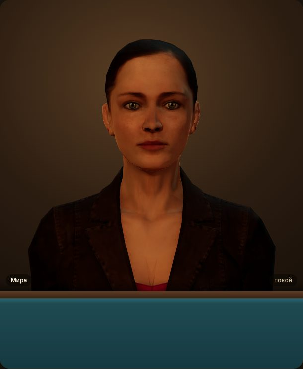 покой (0, 0, 0)                           |  тепло (0.5, −0.25, 0.1)      | 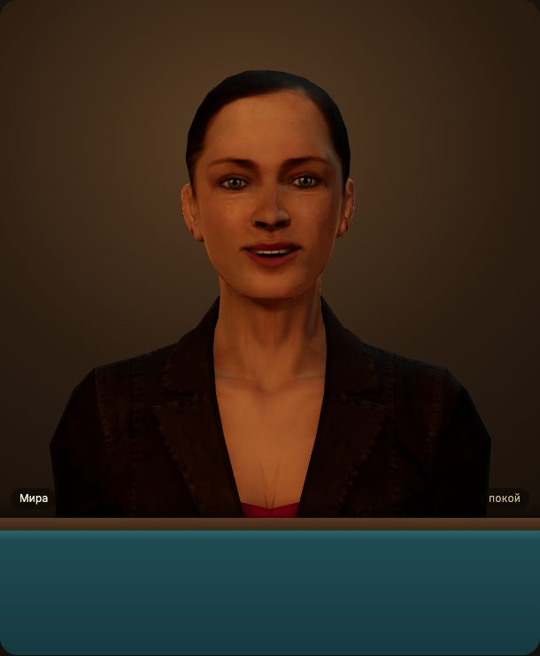 радость (0.85, 0.55, 0.3)    | 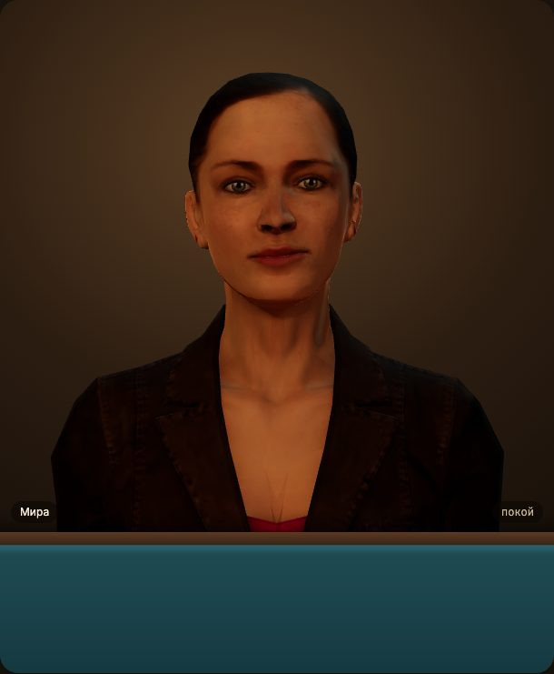 самодовольство (0.35, 0.1, 0.75) |
|  расслабленность (0.25, −0.7, 0.05) | 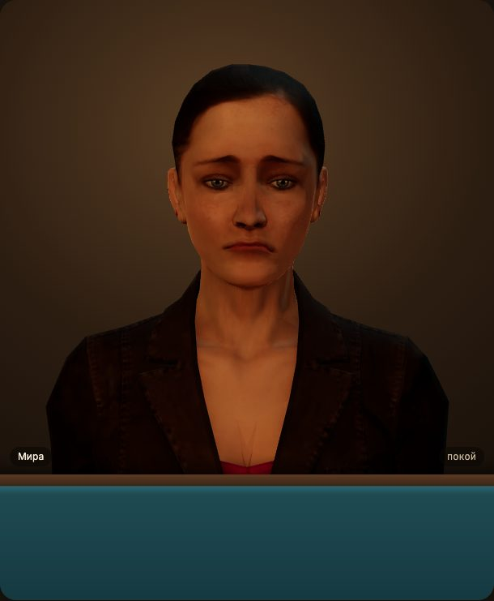 грусть (−0.65, −0.45, −0.4)     |  обида (−0.5, −0.15, 0.2)      |  раздражение (−0.35, 0.35, 0.3) |
|  злость (−0.65, 0.8, 0.65)                  |  сомнение (−0.3, 0.25, −0.5) | 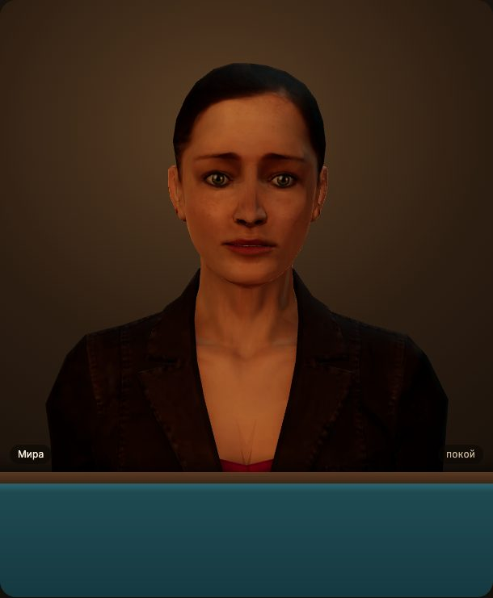 тревога (−0.55, 0.75, −0.7) |                                                                         |

### Реакции и утечки

Каждый импульс эмоции силой ≥ 0.12 даёт на лице короткую реакцию (`web/src/face/expression.ts`, `pulsesFor`). Её
длительность зависит от покерфейса через `s = smoothstep(0.3, 0.75, покерфейс)`:

- открытое лицо (`s = 0`): нарастание 0.12 с, удержание `0.5 + 0.8 · сила`, спад 0.9 с;
- полная маска (`s = 1`): **микровыражение** длиной около 0.3 с, а через 0.3 с подавление: сжатые губы и два
  моргания.

Сила утечки растёт с нейротизмом: `утечка = 1 + 0.5·N`. Сама идея, что подавленная эмоция прорывается коротким
микровыражением, взята у Экмана (направление), тайминги наши.

### Тики мимо маски

Нервозность считается от **испытанного** состояния, поэтому маска её не скрывает:

```
нервозность = 0.7·страх + 0.4·стыд + 0.3·max(0, −D настроения)
частота морганий ×= 1 + 1.6·нервозность + 0.5·max(0, A)
вероятность отвести взгляд на каждой саккаде = 0.06 + 0.75·нервозность
период дыхания = 4.2 − 1.2·нервозность секунд
```

Все коэффициенты здесь дизайнерские. Именно эти тики выдают блефующую Нину и почти не выдают Ингрид.

### Голова

Наклон считается от показанного состояния: `−0.08·D − 0.03·A + 0.07·max(0, −P)`. Уверенная поднимает подбородок,
грустная опускает голову. Боковой наклон `0.04·D`. Голова следует за взглядом на 30–35% (дизайн).

## Голос

Сейчас голос бесплатный: встроенный синтез речи браузера (Web Speech API). Голос выбирается по списку
`Samantha, Google US English, Karen, Moira, ...`, реплики на английском. Параметры речи считаются от показанного
состояния (`web/src/face/prosody.ts`):

```
темп      = clamp(1 + 0.2·A − 0.12·грусть + 0.1·перегрузка, 0.7, 1.4)
высота    = clamp(1 + 0.2·A + 0.1·P − 0.1·грусть, 0.6, 1.5)
громкость = clamp(0.8 + 0.2·A + 0.1·перегрузка, 0.4, 1)
```

Направление связей взято из обзора Juslin and Laukka (2003): при высоком возбуждении (злость, страх, радость) речь
быстрее, выше и громче, при грусти медленнее, ниже и тише. Величины наши.

Губы двигаются по виземам, которые считаются из букв фразы (`web/src/face/visemes.ts`, 15 визем Oculus). Синтез речи
браузера присылает границы слов, и по ним виземы подстраиваются под звук. Это грубая синхронизация. Для настоящей
нужен синтез, который отдаёт время визем или символов (Azure, ElevenLabs), или расчёт мимики прямо по звуку.

## Сцены

Описания сцен ниже, их числа и кадры сделаны на прежней модели: с нагрузкой, драйверами, опытом и прежними
пресетами. Новая модель (оси оценки, напряжение, подход, перекос как проекция аффекта) даёт другие числа; точные
числа текущей модели в [generated.md](generated.md#журналы-сцен), он создаётся из кода.

Двенадцать сцен с настоящими картами (`scenes/scenes.ts`). Для каждой ниже кадр в ключевой момент у всех четырёх
профилей, а для части сцен ещё и панель состояния у Лолы. Полные журналы событий с числами (какое событие какой
импульс дало и почему) лежат в [generated.md](generated.md#журналы-сцен).

### Бэд-бит

A♠A♥ против J♠T♠, доска K♣ 9♦ 2♠ 3♥ Q♥. Ол-ин на тёрне при 91% (у соперника 4 аута на стрит), ривер Q♥. Ключевой
момент: 9 с, через 0.6 с после итога. Удивление, огорчение, разочарование и несправедливость у всех, радости от
тузов, пережившей проигрыш, больше нет. У Лолы и Нины
перегрузка 1.00, и игра уходит в широту ×1.60 и коллы до конца ×1.62. У Ингрид перегрузка 0.91, но до игры доходит
7%, и её перекос почти не меняется (×1.01–1.04).

| Мира                      | Ингрид                      | Лола                      | Нина                      |
| ------------------------- | --------------------------- | ------------------------- | ------------------------- |
|  | 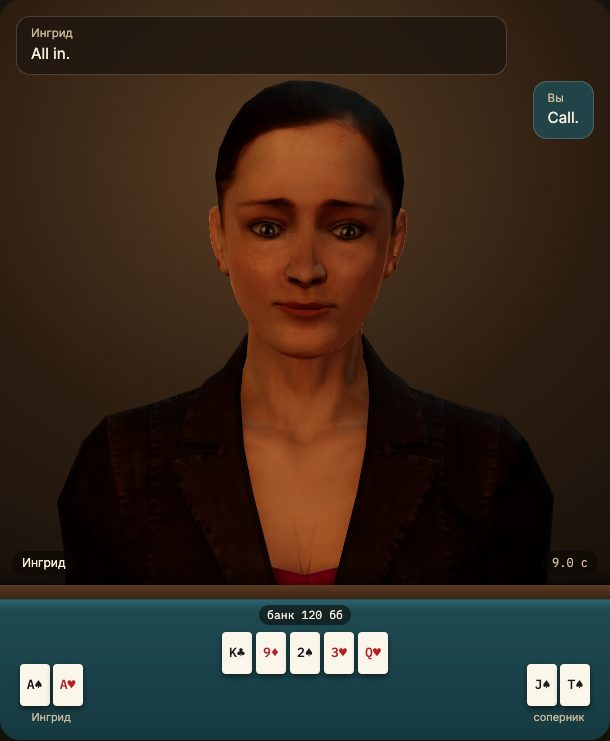 | 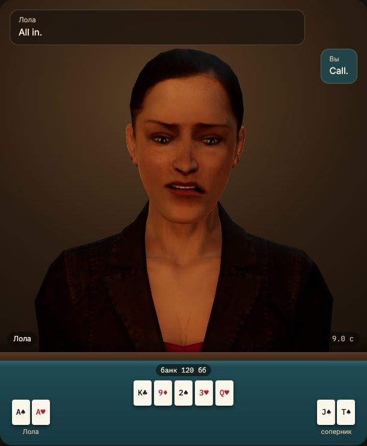 |  |

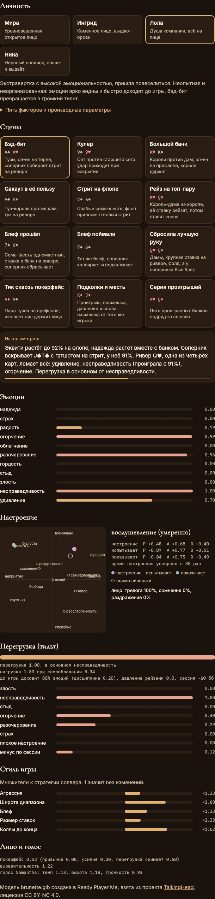

### Кулер

9♠9♥ против K♦K♠, доска K♣ 9♦ 2♥ 5♠ 3♣. Нижний сет против верхнего. Удар приходит при вскрытии (около 90% против
случайной руки превращаются в 4%), а не на ривере. Ключевой момент: 6 с, сразу после вскрытия. Страх (0.67 у Миры,
0.91 у Лолы и Нины) и удивление высокие, разочарование лёгкое, а несправедливости нет: доска ещё открыта, и потеря
придёт с итогом.

| Мира                     | Ингрид                     | Лола                     | Нина                     |
| ------------------------ | -------------------------- | ------------------------ | ------------------------ |
|  |  |  |  |

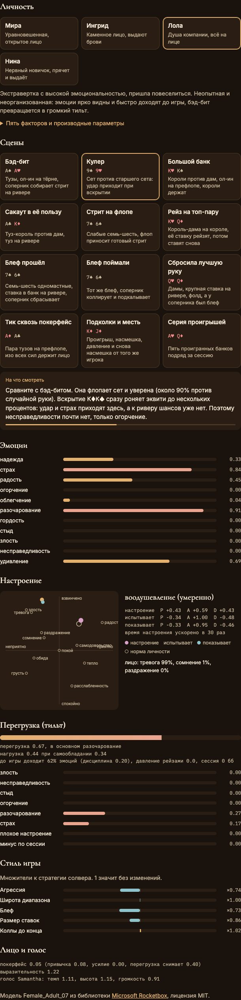

### Большой банк

K♥K♠ против Q♦Q♣, ол-ин на префлопе, доска 7♠ 4♦ 2♣ J♥ 3♠. Ключевой момент: 7.6 с. Радость и облегчение.

| Мира                     | Ингрид                     | Лола                     | Нина                     |
| ------------------------ | -------------------------- | ------------------------ | ------------------------ |
|  |  | 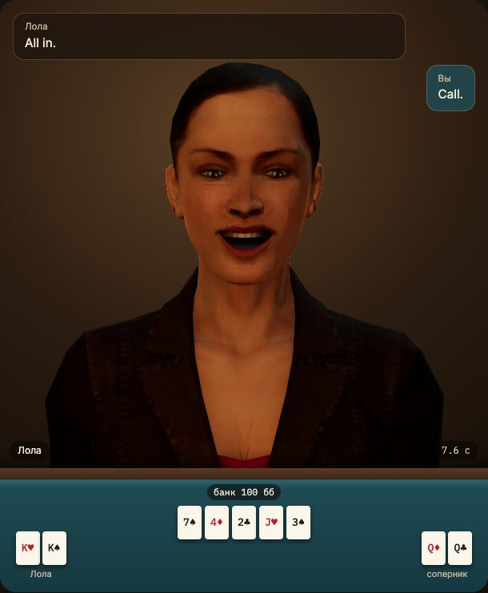 |  |

### Сакаут в её пользу

A♣K♦ против Q♠Q♥, доска 8♣ 5♦ 2♠ J♣ A♥. На тёрне у неё 14% (6 аутов из 44). Ключевой момент: 8.3 с. Радость,
облегчение и удивление.

| Мира                      | Ингрид                      | Лола                      | Нина                      |
| ------------------------- | --------------------------- | ------------------------- | ------------------------- |
| 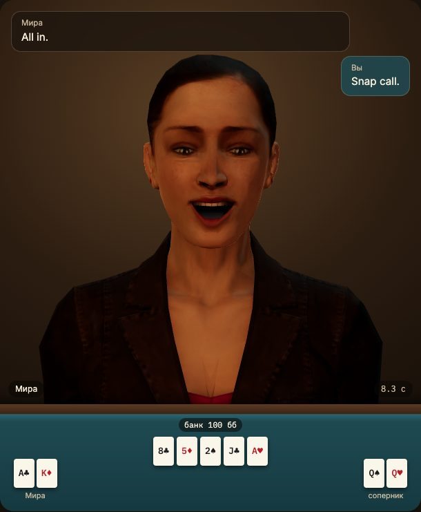 |  |  | 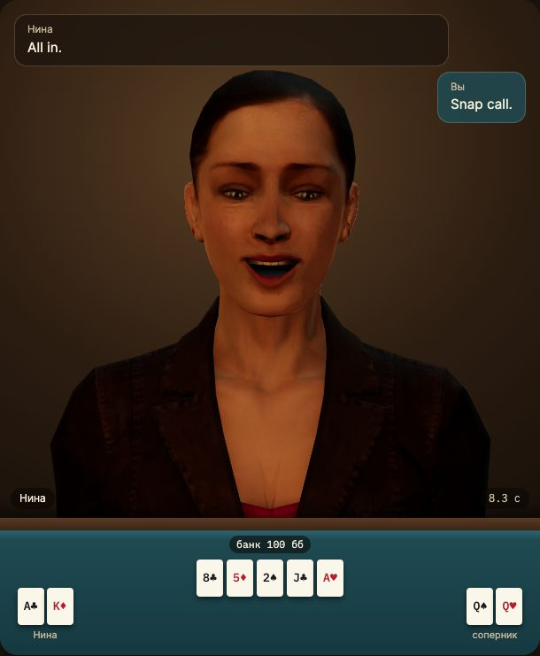 |

### Стрит на флопе

7♠6♠, флоп 8♦ 9♣ T♥ даёт готовый стрит, эквити с 46% до 86%. Банк всего 6 бб, но впереди две улицы и стек, поэтому
«можно выиграть» 15 бб. Ключевой момент: 2.4 с, через 0.8 с после флопа. Вспышка надежды и лёгкое удивление; через
0.8 с надежда уже вернулась к цели напряжения (0.13 у Миры, 0.14 у Лолы). Радость придёт с выигрышем. Перегрузки нет,
перекос не меняется: хорошие новости до игры почти не доходят, и это нормально.

| Мира                           | Ингрид                           | Лола                           | Нина                           |
| ------------------------------ | -------------------------------- | ------------------------------ | ------------------------------ |
|  |  | 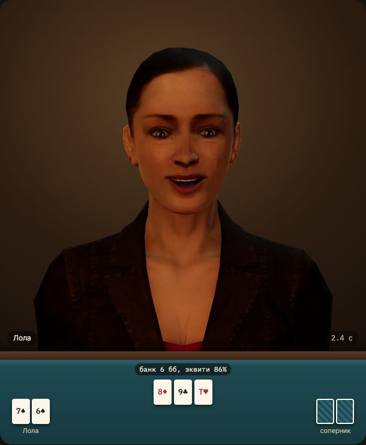 |  |

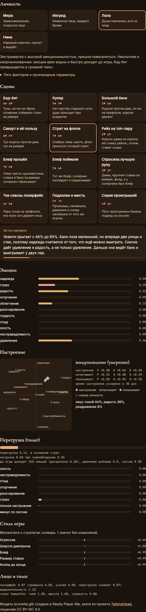

### Рейз на топ-пару

K♥Q♦ на K♣ 8♦ 4♠, она ставит 4 бб, соперник рейзит до 14. Рейз даёт страх и злость как вызов; сужение его диапазона
по блупринту V1 роняет эквити с 87% до 74%: это его действие, поэтому удивления нет, растёт страх. Ключевой момент: 4.4 с. Нина: страх 0.41, перегрузка 0.36 (в основном злость), перекос почти не меняется
(агрессия ×0.97). Ингрид: страх 0.23, перегрузки нет. На тёрне 8♥ и его ставка 25 бб: диапазон сужается ещё раз,
эквити 63%, она сбрасывает, и несбывшаяся надежда даёт разочарование.

| Мира                           | Ингрид                           | Лола                           | Нина                           |
| ------------------------------ | -------------------------------- | ------------------------------ | ------------------------------ |
|  | 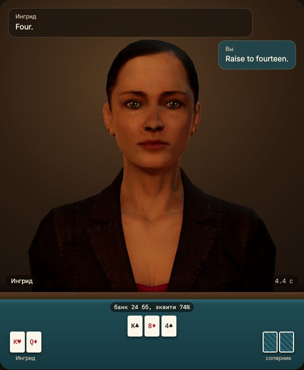 | 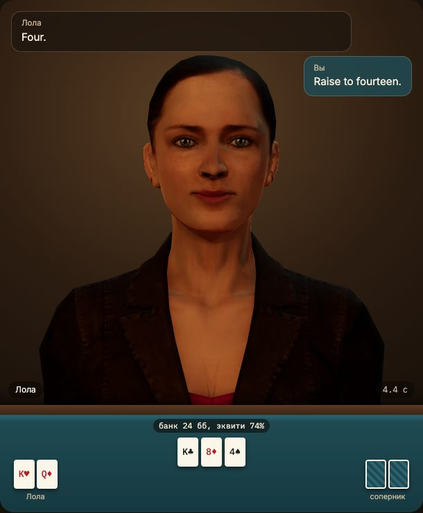 | 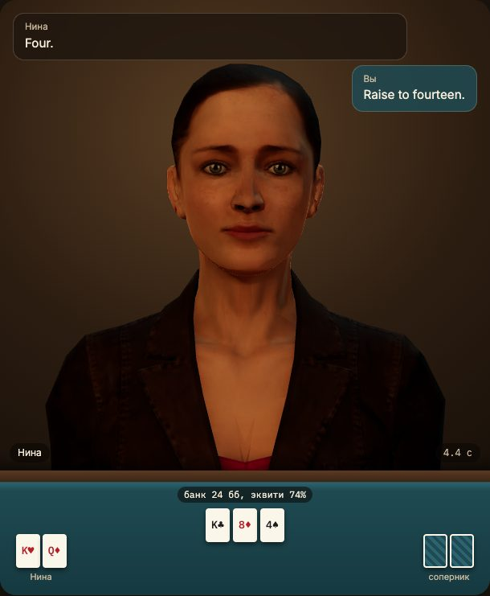 |

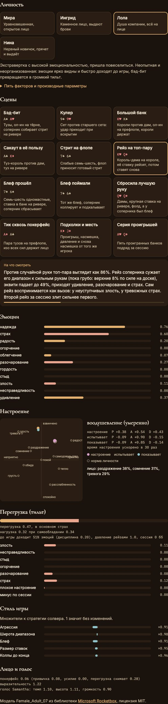

### Блеф прошёл

7♠6♠ на доске A♦ K♣ 3♥ 4♦ Q♣, ставка в банк на ривере, вложено 50 бб. Усилие покерфейса 0.6, роль «уверенность».
Ключевой момент: 8.5 с, пока соперник думает. Лицо ровное или уверенное, страх под маской (0.84 у Миры, 0.97 у
Лолы). Его выдают тики: моргание и взгляд в сторону.

| Мира                       | Ингрид                       | Лола                       | Нина                       |
| -------------------------- | ---------------------------- | -------------------------- | -------------------------- |
|  |  | 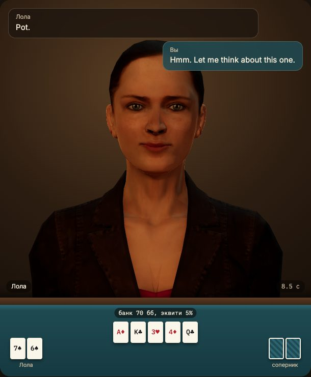 |  |

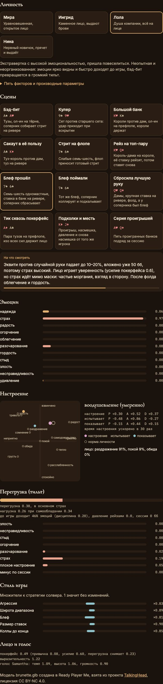

### Блеф поймали

Та же раздача, соперник коллирует с A♥J♥ и подкалывает. Ключевой момент: 11.6 с, после насмешки. Стыд, огорчение и
злость, перегрузка в основном от стыда. Стыд и злость тянут перекос в разные стороны; у Лолы стыд пересиливает:
агрессия ×0.79, блеф ×0.77.

| Мира                          | Ингрид                          | Лола                          | Нина                          |
| ----------------------------- | ------------------------------- | ----------------------------- | ----------------------------- |
| 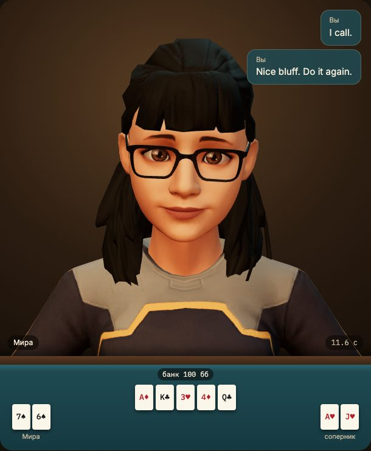 | 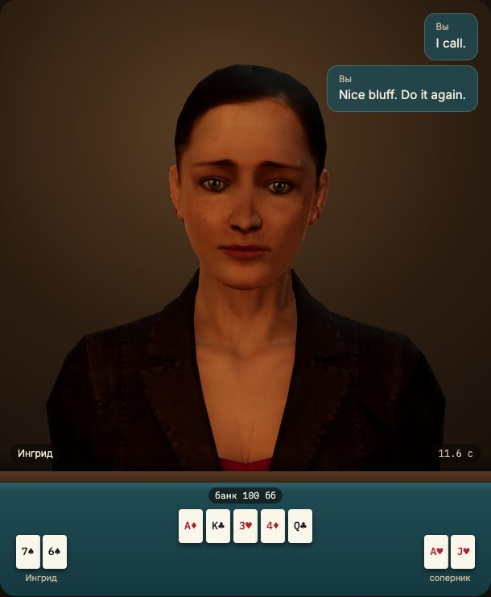 | 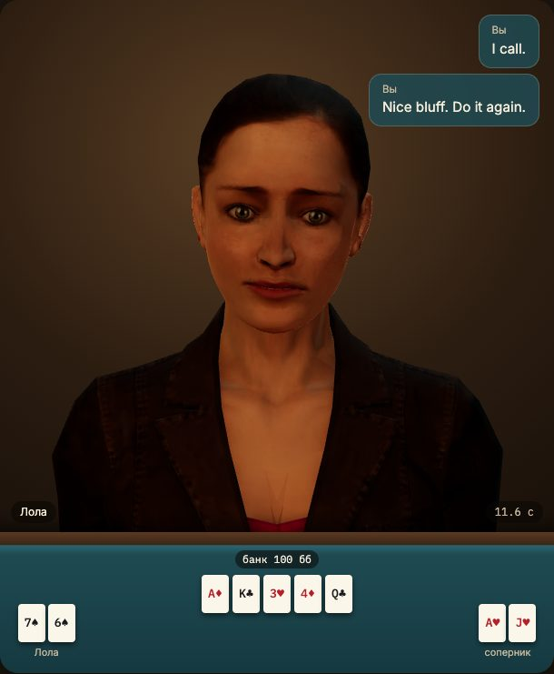 | 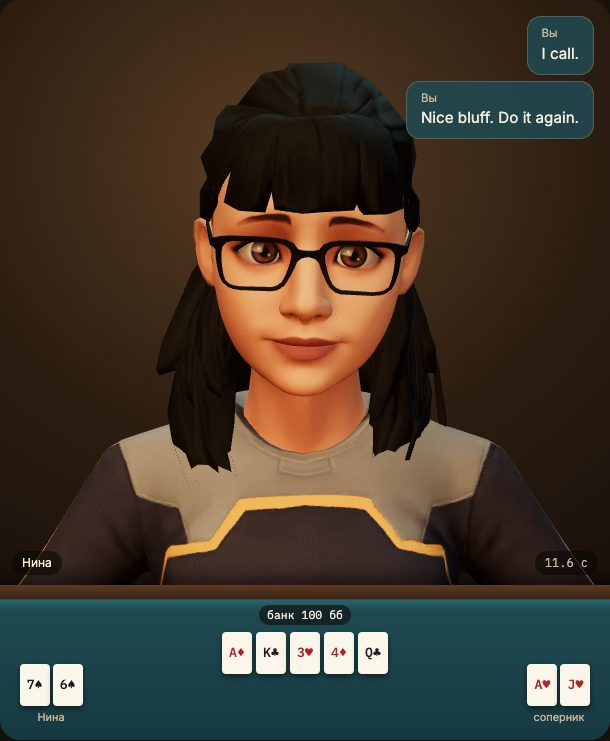 |

### Сбросила лучшую руку

Q♥Q♦ на доске K♠ 8♣ 4♦ 2♥ 9♠, соперник ставит 40 бб на ривере, она сбрасывает, он показывает 7♣6♣. Ключевой момент:
10.9 с. Сброс 20 бб при вере 50% это потеря: огорчение, разочарование и стыд (у Миры 0.37, 0.20 и 0.22, у Нины
0.56, 0.27 и 0.46), у Ингрид в основном злость 0.33. Перегрузка у Лолы 0.89, у Нины 0.90, у Миры 0.60; агрессия
у Нины ×0.54, у Миры ×0.81.

| Мира                      | Ингрид                      | Лола                      | Нина                      |
| ------------------------- | --------------------------- | ------------------------- | ------------------------- |
|  | 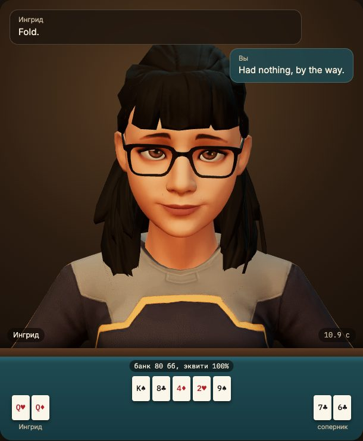 | 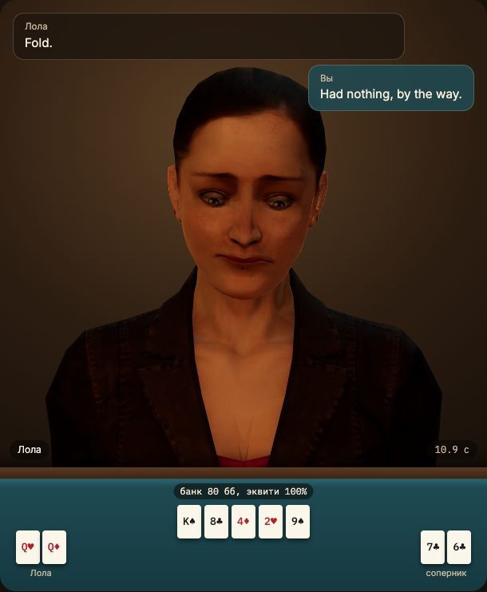 |  |

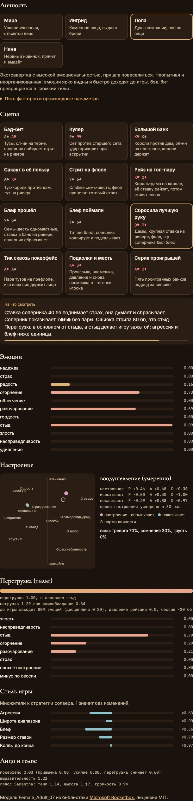

### Тик сквозь покерфейс

A♦A♣ на префлопе, усилие покерфейса 0.85. Ключевой момент: 1.2 с, на пике микровыражения: тузы дают вспышку надежды
(брови вверх и короткая улыбка), а не радость. У Лолы оно видно
даже сквозь маску, у Ингрид почти нет. В песочнице это лучше смотреть с замедлением.

| Мира                   | Ингрид                   | Лола                   | Нина                   |
| ---------------------- | ------------------------ | ---------------------- | ---------------------- |
|  |  | 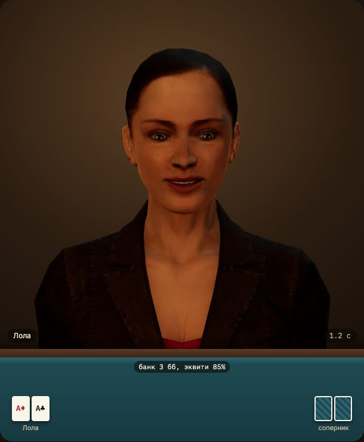 |  |

### Подколки и месть

Три раздачи против одного игрока: проигрыш с подколкой, давление ставкой с насмешкой, ещё одна подколка. Ключевой
момент: 11.7 с, перед её агрессивным рейзом. Перегрузка в основном от злости: у Лолы 1.00, агрессия ×1.19,
блеф ×1.30, широта ×1.39. У Миры перегрузка тоже почти полная (0.99), но до игры доходит 44%: агрессия ×1.09.

| Мира                      | Ингрид                      | Лола                      | Нина                      |
| ------------------------- | --------------------------- | ------------------------- | ------------------------- |
| 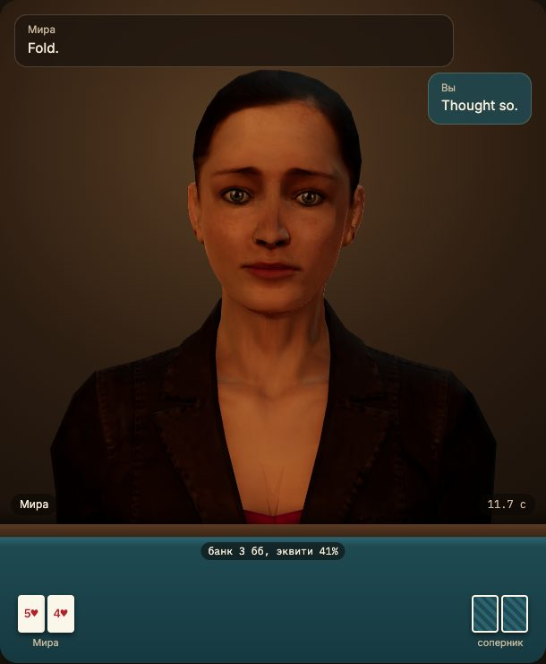 |  |  | 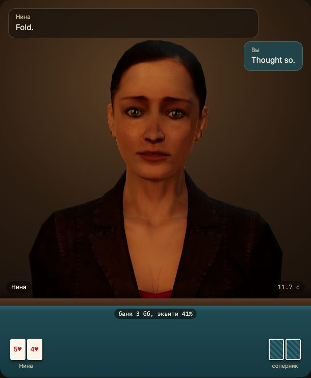 |

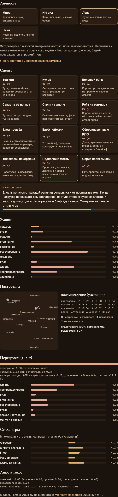

### Серия проигрышей

Пять проигранных банков подряд, минус 205 бб. Ключевой момент: 12.5 с. Перегрузка в основном от минуса по сессии:
у Лолы широта ×1.43 и коллы до конца ×1.49, она отыгрывается. У Миры ×1.24 и ×1.27.

| Мира                     | Ингрид                     | Лола                     | Нина                     |
| ------------------------ | -------------------------- | ------------------------ | ------------------------ |
|  |  |  | 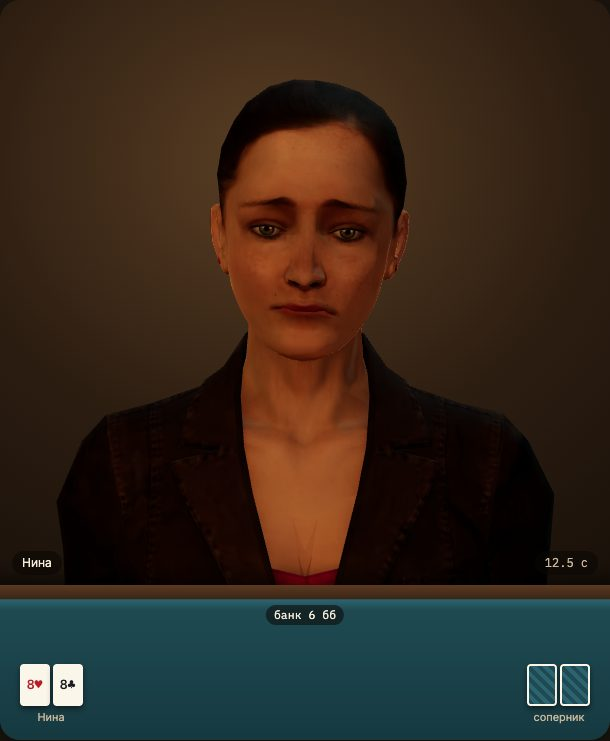 |

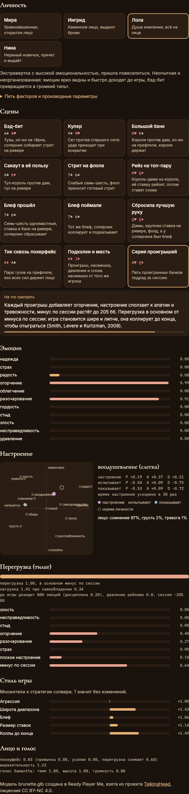

## Связь с разговорным агентом

Разговор устроен как планировщик: что сказать, решает код из её состояния и хода раздачи, а модель только подбирает
слова. Подробно в `docs/conversation/README.md`; ниже история этой связи.

Сделано (`web/src/persona`): персонаж за столом ведёт движок по событиям настоящей раздачи, а разговор
(`web/src/conversation`), лицо и бот только читают его снимок. Её карты, каждая
улица, ставки и вскрытие идут с её эквити (против диапазона игрока по блупринту, пока он не показал карты, потом
против его карт) и деньгами; рейз игрока в ответ на её ставку идёт как вызов; итог оценивается по её эквити против его
показанных карт на той доске, при которой ушли деньги (так бэд-бит отличается от кулера, хотя карты в игре
открываются только после ривера); пойманный и прошедший блеф слабой поздней ставкой; сигналы чата. От движка идут
пять осей перекоса бота, до трёх слов настроения для промпта («on tilt» при перегрузке от 0.6, затем эмоции от 0.25)
и частота реплик (растёт с возбуждением выше нормы и перегрузкой). Эмоции считает только движок; LLM по-прежнему
только разбирает реплику игрока в сигналы и пишет её реплики.

### Дальше: богаче состояние в промпте

Сейчас сервер получает только слова. Следующий шаг по тому же принципу:

- в промпт уходят две-три сильные эмоции с силой, настроение по октанту, перегрузка с главным источником, что она
  **показывает** сквозь покерфейс и насколько прорывается настоящее, и манера речи из личности (экстраверсия
  задаёт разговорчивость и длину реплик, доброжелательность вежливость, нейротизм тревожность формулировок);
- LLM возвращает текст и подачу `{ text, delivery: { emotion, intensity } }` для синтеза речи с эмоциями.

### Почему не одна модель «голос плюс эмоции»

Голосовые модели «речь в речь» (Hume EVI, realtime-модели) сами решают, что персонаж чувствует и что говорит. Это
ломает схему с одним источником правды: эмоции разойдутся с игрой и лицом, их нельзя будет протестировать и
воспроизвести, а оплата у них поминутная. Такие сервисы стоит использовать только как синтез речи.

### Как измерить, насколько эмоции влияют на реплики

1. Набор ситуаций: сцены из песочницы, каждая с несколькими эмоциональными состояниями.
2. LLM генерирует реплики для каждого состояния.
3. Модель-судья определяет, какую эмоцию и с какой силой передаёт реплика; считаем совпадение с заданным
   состоянием и отдельно проверяем покерфейс.
4. Промпт правим, пока совпадение не дойдёт до целевого уровня.

## Что не готово

- Соперник моделируется как среднее блупринта; его собственные привычки (#21) не учитываются.
- Коэффициенты перекоса игры и природной манеры не откалиброваны по данным (план выше); арена меряет их цену.
- Усталость за длинную сессию не моделируется; давление рейзами считается к одному сопернику.
- Опорные выражения лица подобраны на глаз; откалибровать их можно записью мимики через ARKit (Live Link Face) или
  по таблицам EMFACS.
- Причины импульсов в журнале песочницы на английском: их пишет движок игры.

## Источники

- Gebhard, P. (2005). ALMA: A Layered Model of Affect. AAMAS. https://alma.dfki.de/papers/aamas05.pdf
- Mehrabian, A. (1996). Analysis of the Big-five Personality Factors in Terms of the PAD Temperament Model.
  Australian Journal of Psychology, 48(2).
- Ortony, A., Clore, G. L., and Collins, A. (1988). The Cognitive Structure of Emotions. Cambridge University Press.
- Lerner, J. S., and Keltner, D. (2001). Fear, anger, and risk. Journal of Personality and Social Psychology, 81(1).
- Raghunathan, R., and Pham, M. T. (1999). All negative moods are not equal. Organizational Behavior and Human
  Decision Processes, 79(1).
- Thaler, R. H., and Johnson, E. J. (1990). Gambling with the house money and trying to break even. Management
  Science, 36(6).
- Smith, G., Levere, M., and Kurtzman, R. (2009). Poker Player Behavior After Big Wins and Big Losses. Management
  Science, 55(9). https://econpapers.repec.org/RePEc:inm:ormnsc:v:55:y:2009:i:9:p:1547-1555
- Palomäki, J., Laakasuo, M., and Salmela, M. (2013). "This is just so unfair!": A qualitative analysis of
  loss-induced emotions and tilting in on-line poker. International Gambling Studies, 13(2).
- Tendler, J. (2011). The Mental Game of Poker.
- Gross, J. J., and John, O. P. (1997). Revealing feelings: Facets of emotional expressivity. Journal of Personality
  and Social Psychology, 72(2).
- Gross, J. J., and John, O. P. (2003). Individual differences in two emotion regulation processes. Journal of
  Personality and Social Psychology, 85(2).
- Suls, J., and Martin, R. (2005). The daily life of the garden-variety neurotic. Journal of Personality, 73(6).
- Juslin, P. N., and Laukka, P. (2003). Communication of emotions in vocal expression and music performance.
  Psychological Bulletin, 129(5).
- Ekman, P., and Friesen, W. V. (1978). Facial Action Coding System.
- Nicholson, N., Soane, E., Fenton-O'Creevy, M., and Willman, P. (2005). Personality and domain-specific risk taking.
  Journal of Risk Research, 8(2). https://doi.org/10.1080/1366987032000123856
- Brown, S. C., and Mitchell, L. A. (2010). An observational investigation of poker style and the five-factor
  personality model. Journal of Gambling Studies, 26(2). https://doi.org/10.1007/s10899-009-9161-9
- Lauriola, M., and Levin, I. P. (2001). Personality traits and risky decision-making in a controlled experimental
  task. Personality and Individual Differences, 31(2). https://doi.org/10.1016/S0191-8869(00)00130-6
- Barry, B., and Friedman, R. A. (1998). Bargainer characteristics in distributive and integrative negotiation.
  Journal of Personality and Social Psychology, 74(2). https://doi.org/10.1037/0022-3514.74.2.345
- Heck, D. W., Thielmann, I., Moshagen, M., and Hilbig, B. E. (2018). Who lies? A large-scale reanalysis linking
  basic personality traits to unethical decision making. Judgment and Decision Making, 13(4).
  https://doi.org/10.1017/S1930297500009232
- Palomäki, J., Yan, J., and Laakasuo, M. (2016). Machiavelli as a poker mate: A naturalistic behavioural study on
  strategic deception. Personality and Individual Differences, 98. https://doi.org/10.1016/j.paid.2016.03.089
- MacLaren, V. V., Fugelsang, J. A., Harrigan, K. A., and Dixon, M. J. (2011). The personality of pathological
  gamblers: A meta-analysis. Clinical Psychology Review, 31(6). https://doi.org/10.1016/j.cpr.2011.02.002
- Dudfield, F. W. H., Malouff, J. M., and Meynadier, J. (2023). The association between the five-factor model of
  personality and problem gambling: a meta-analysis. Journal of Gambling Studies, 39(2).
  https://doi.org/10.1007/s10899-022-10119-5
- Siler, K. (2010). Social and psychological challenges of poker. Journal of Gambling Studies, 26(3).
  https://doi.org/10.1007/s10899-009-9168-2
- Palomäki, J., Laakasuo, M., and Salmela, M. (2013). "Don't worry, it's just poker!" Experience, self-rumination and
  self-reflection as determinants of decision-making in on-line poker. Journal of Gambling Studies, 29(3).
  https://doi.org/10.1007/s10899-012-9311-3
- Palomäki, J., Laakasuo, M., and Salmela, M. (2014). Losing more by losing it: Poker experience, sensitivity to
  losses and tilting severity. Journal of Gambling Studies, 30(1). https://doi.org/10.1007/s10899-012-9339-4
- Eil, D., and Lien, J. W. (2014). Staying ahead and getting even: Risk attitudes of experienced poker players.
  Games and Economic Behavior, 87. https://doi.org/10.1016/j.geb.2014.04.008
- Laakasuo, M., Palomäki, J., and Salmela, M. (2014). Experienced poker players are emotionally stable.
  Cyberpsychology, Behavior, and Social Networking, 17(10). https://doi.org/10.1089/cyber.2014.0147
- Anthropic (2026). Emotion Concepts and their Function in a Large Language Model.
  https://transformer-circuits.pub/2026/emotions/ (фон: эмоции внутри самой LLM, в модели не используется).
